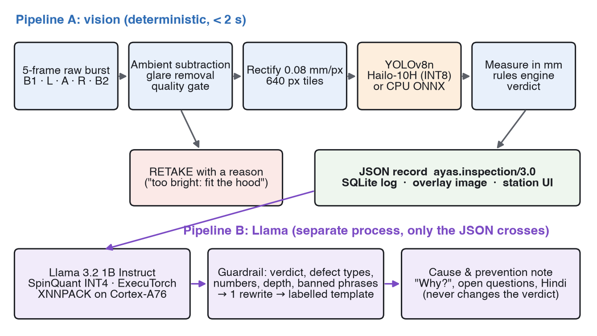
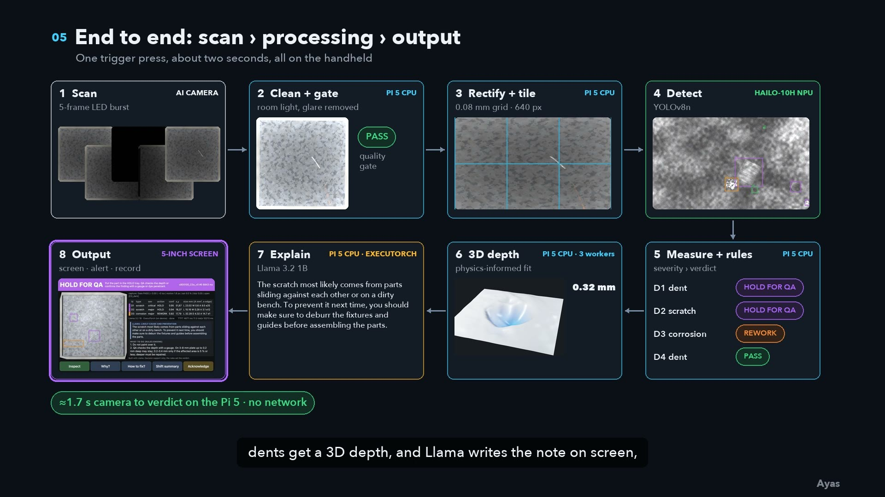
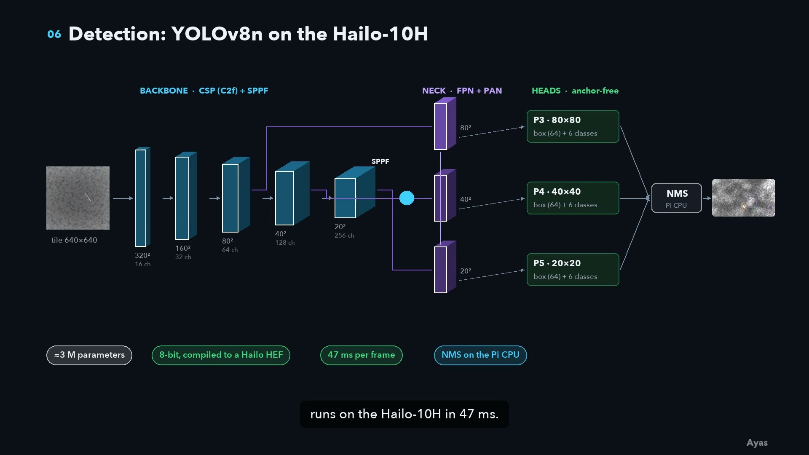
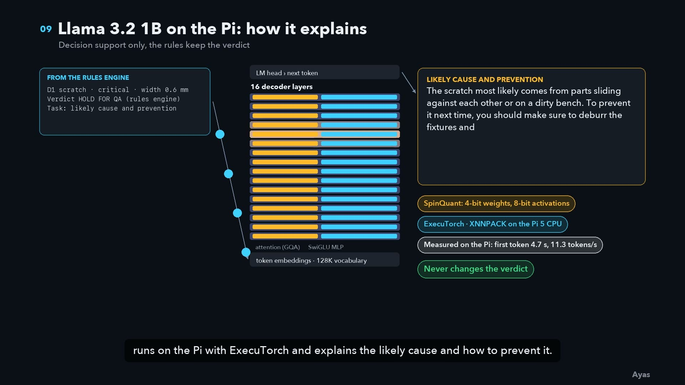
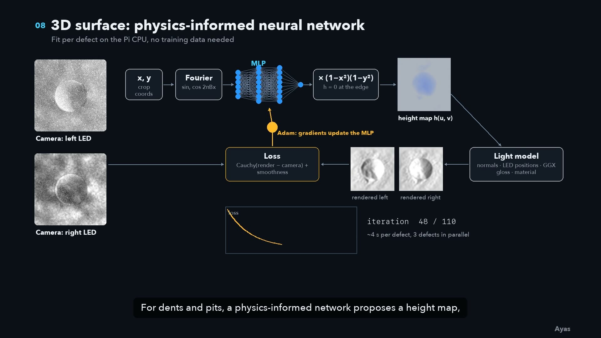
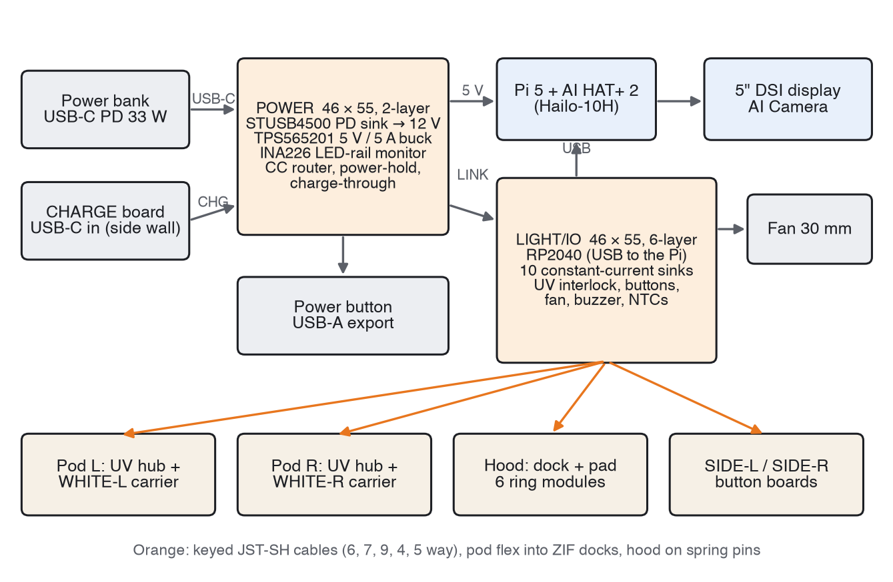
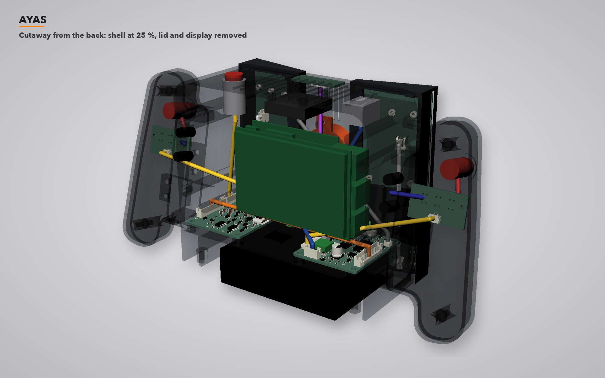

# Ayas architecture

How the whole system fits together: the device, the two pipelines, every model, the data contract, the processes and the electronics. Results and the reasoning behind each choice are in the project report (`docs/report/Ayas_Project_Report.pdf`).

## 1. System overview



Ayas has two pipelines that share one JSON record and nothing else:

| Pipeline | Job | Character | Code |
|---|---|---|---|
| **A: vision** | Burst → gate → rectify → tile → detect → measure → rules → verdict | Deterministic, < 2 s on the Pi; it alone decides the verdict | `src/ayas/lightproc.py`, `tiles.py`, `npu.py`, `rules.py`, `report.py`, `store.py`, `app/pipeline.py` |
| **B: Llama** | Cause-and-prevention note, "Why?", open questions (Hindi too) | Separate process, behind a guardrail; it never changes the verdict | `src/ayas/llm.py`, `app/advisor.py` |
| **3D (on demand)** | Height map, depth and uncertainty per dent, pit or scratch | Worker processes; a measurement aid, not in the verdict | `src/ayas/app/surface3d.py`, `physics/depth_pinn.py` |



## 2. Pipeline A: vision

| Stage | What it does | Runs on |
|---|---|---|
| Capture | 5-frame raw burst **B1 · L · A · R · B2** (LEDs off, left, both, right, off) at a fixed 10 ms exposure, fixed gain and white balance; no auto-exposure, no ISP | AI Camera (IMX500) in raw mode |
| Light processing | Ambient subtraction from mean(B1, B2); glare removal from L and R (min for the open pods, mean for the hood ring); motion and flicker from B1 against B2 and the closure of L + R against A | Cortex-A76, NumPy |
| Quality gate | Ambient ratio, saturated and masked fractions, motion, flicker, closure residual, hood leak → **PASS / PASS_FLAGGED / RETAKE** with a plain reason | Cortex-A76 |
| Rectify and tile | Plate homography to a 0.08 mm/px grid with a 5 mm border; 640 px tiles with ≥ 128 px overlap | Cortex-A76 |
| Detect | YOLOv8n, 6 classes; seam merge across tiles | Hailo-10H (INT8 HEF) or ONNX Runtime on the CPU |
| Measure | Length, width, area, equivalent diameter, distance to the nearest edge or hole, in mm | Cortex-A76 |
| Rules | `configs/spec_steel.yaml`: severity tier and disposition per defect; the verdict is the worst disposition (PASS < CLEAN_AND_REINSPECT < REWORK < HOLD_FOR_QA < REJECT); low confidence → HOLD_FOR_QA; two-burst confirmation for cracks (P1h); hood-only certification | Cortex-A76 |
| Record | JSON record `ayas.inspection/3.0` (`schemas/`), SQLite log, overlay image, station UI | Cortex-A76 |

## 3. The models

### 3.1 YOLOv8n defect detector



| | |
|---|---|
| Architecture | YOLOv8n (~3 M parameters): CSP backbone with SPPF, FPN + PAN neck, three anchor-free decoupled heads at strides 8, 16, 32 (P3–P5) |
| Input | 640 × 640 tile of the burst-processed, rectified plate grid (0.08 mm/px), native scale |
| Classes | scratch, dent, pit, corrosion, crack, stain |
| Training | Ultralytics, from COCO `yolov8n.pt`, 150 epochs, light colour and scale augmentation; 5,176 / 430 tiles from 800 twin scenes (`training/train_arms.py`) |
| Baseline | The same network trained on single auto-exposed frames (`v8n_naive.onnx`), for the lighting experiment only |
| CPU model | `models/v8n_burst.onnx` (12.8 MB), ONNX Runtime; agrees with PyTorch to 0.0013 on the raw head output |
| NPU model | `models/v8n_burst.hef`: Hailo DFC 5.1, INT8 with 1,024 calibration tiles, cut at the six head convolutions, on-chip NMS (score 0.2); 47 ms per inspection |

### 3.2 Llama 3.2 1B Instruct via ExecuTorch



| | |
|---|---|
| Architecture | Decoder-only transformer, 16 layers, grouped-query attention, 128K-token vocabulary |
| Checkpoint | Meta `Llama-3.2-1B-Instruct-SpinQuant_INT4_EO8`: 4-bit weights (group 32), 8-bit embeddings |
| Runtime | ExecuTorch v1.6 `.pte` (1.08 GB) with the XNNPACK delegate on the Cortex-A76 (4 threads); `llama_main` as a separate process, or the in-process `TextLLMRunner` |
| Inputs | The JSON record only (never the image): a ~611-token prompt for the cause note, a ~860-token plain-text brief for follow-ups; at most 160 new tokens |
| Division of labour | The rules engine writes the verdict, the deciding defects with their measurements and rule, and the steps; Llama writes the cause and prevention note and answers questions |
| Guardrail | `llm.check_steel_reply`: no contradiction of the verdict, no defect type, number or depth that is not in the record, no banned phrase, only whitelisted references; one rewrite, then a labelled template |
| Pi 5 | First token 5.4 s, 11 tok/s decode, 112 tok/s prefill, note in 10.3 s, 1.38 GB |

### 3.3 Physics-informed neural network (PINN) for depth



A neural field fitted per defect so that a physical light model of its surface reproduces the LED frames. It needs no training data.

```
h(u, v)  = D(x, y) · s_h · MLP([sin 2πBx, cos 2πBx])        D = (1 − x²)(1 − y²): h = 0 on the crop border
S_g      = k e^{a_g} [ m(u, v) L_g(n(h)) + e^{e_g} Env_g(n(h)) ] + b_g     rendered frame for LED group g
loss     = mean ρ((S_g − O_g)/σ) + λ_c |Hess h|² + λ_s relu(h − τ)² + priors
```

| | |
|---|---|
| Network | 48 random Fourier features (σ = 1.2 cycles per half-crop) → 2 hidden layers of 64 (SiLU) → 2 outputs: height and the log of a smooth material factor m(u, v) |
| Physics | `physics/optics.py`: GGX/Principled shading of each LED group, the hood's one-bounce inter-reflection, sensor noise model; ρ is the Cauchy loss |
| Fit | Material parameters first on the crop border, then Adam (220 iterations, lr 4e-3); 1–3 seeds for the ensemble spread; calibrated 90 % interval |
| On the Pi | 3 worker processes, one defect each; fast mode halves the steps; ~15 s for a plate with 5 defects |
| Result (twin) | Dent MAE 0.053 mm with L/R, 0.021 mm with 6 sectors; 2.1–3.4× better than classical integration |

### 3.4 Models tried and not adopted

| Model | Architecture | Why not |
|---|---|---|
| I-JEPA anomaly map | ViT-Tiny, self-supervised across lighting pairs; predictor error as the anomaly score | Region AUROC 0.975 hood / 0.957 open did not beat ResNet18 PatchCore (0.965 / 0.957) by the pre-set +0.02; too slow for the Pi (`docs/JEPA.md`) |
| Depth network | U-Net (width 24) from the L/R crops to a height map, trained on synthetic crops then fine-tuned on Blender crops (`training/depthnet/`, `models/depthnet_blender.onnx`) | Dent MAE 0.149 mm against 0.022 mm for the PINN |
| ResNet18 PatchCore | ImageNet ResNet18 features with a memory bank | Competitive; thresholds not yet calibrated: a Phase 2 candidate |

## 4. Data and the digital twin

- **Twin** (`src/ayas/twin/`): Blender 5.2 Cycles. Six steel and metal finishes and six defect classes with physical geometry and exact ground truth. Unlabelled distractors. The device modelled from the CAD (LEDs, hood, camera). Seven lighting conditions from 0 to ~45,000 lux. A sensor noise model. The same `lightproc.py` as the device. Seeds and counts are in `DATASETS.md`.
- **Record schema** (`schemas/`): `ayas.inspection/3.0` holds:
  - the part;
  - the capture (mode, gate result and metrics);
  - each defect (class, confidence, box, mm location and size, edge distance, severity, disposition, rule);
  - the verdict and instruction;
  - the backends.

## 5. Processes on the device

| Process | Role |
|---|---|
| `ayas-app` | Camera or twin source, Pipeline A, SQLite log, the 800 × 480 station web UI |
| Llama runner | ExecuTorch `llama_main` (or in-process runner); fed the record, streams tokens to the UI after the verdict is shown |
| 3D workers | A warm pool of 3 PINN fit processes |
| RP2040 firmware (Phase 2) | LED burst timing and set-points, buttons, power-hold, UV interlock, fan, buzzer; USB serial to the Pi (`docs/hardware/controls.md`) |

## 6. Hardware architecture



- **Compute:** Raspberry Pi 5 (Cortex-A76 ×4, 8 GB) with the AI HAT+ 2 (Hailo-10H); Raspberry Pi AI Camera; Waveshare 5-inch DSI display.
- **Power:** USB-C PD bank → POWER board (12 V PD sink, 5 V / 5 A buck, rail monitor, power-hold, charge-through).
- **Light and I/O:** LIGHT/IO board, 6-layer:
  - an RP2040;
  - 10 constant-current sinks (white L/R, UV L/R, 6 hood-ring sectors);
  - the UV interlock;
  - buttons, fan and buzzer.
- **Light modules:**
  - **Per pod:** a UV hub (9 plug-in 395 nm LEDs) and a WHITE carrier (three 12 V white modules).
  - **Hood:** six white modules in a ring, on spring-pin contacts.
- **Housing and assembly:** `hardware/enclosure/` (Fusion 360 generators); boards in `hardware/pcb/` (KiCad 10, generated from `design.py`). Specification: `docs/hardware/pcb_phase2.md`. Service manual: `docs/hardware/service.md`.



## 7. Code map

| Path | Contents |
|---|---|
| `src/ayas/` | lightproc, tiles, npu, rules, report, store, llm, physics/, twin/, app/ |
| `training/` | Detector training per capture arm, export, lighting evaluation, JEPA and depth-network experiments |
| `hailo/` | HEF compilation |
| `models/` | Detector ONNX + HEF, depth-network ONNX; how to make the Llama `.pte` |
| `configs/` | capture, twin, steel spec, app (controls, power, export) |
| `hardware/` | Fusion 360 housing and assembly; 13 KiCad boards and their generators |
| `tools/` | GPU-box jobs, the Pi measurement run, demo video sources (`video/`), report generator (`report/`) |
| `reports/` | Lighting matrix, JEPA, PINN, Pi benchmarks, figures, demo videos |
| `tests/` | pytest suite (~870 tests) |
