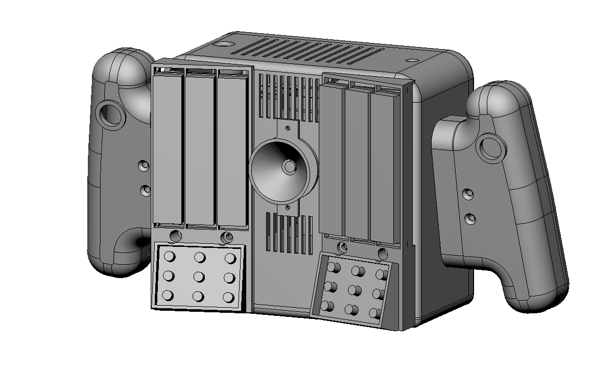
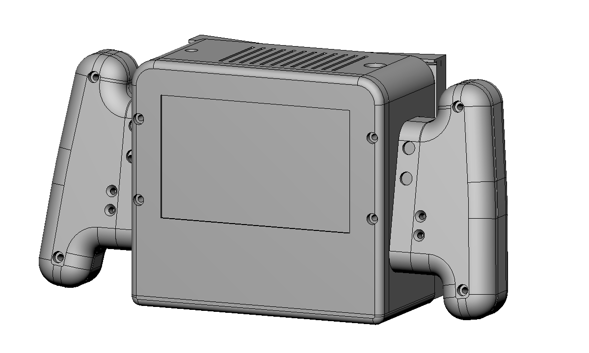
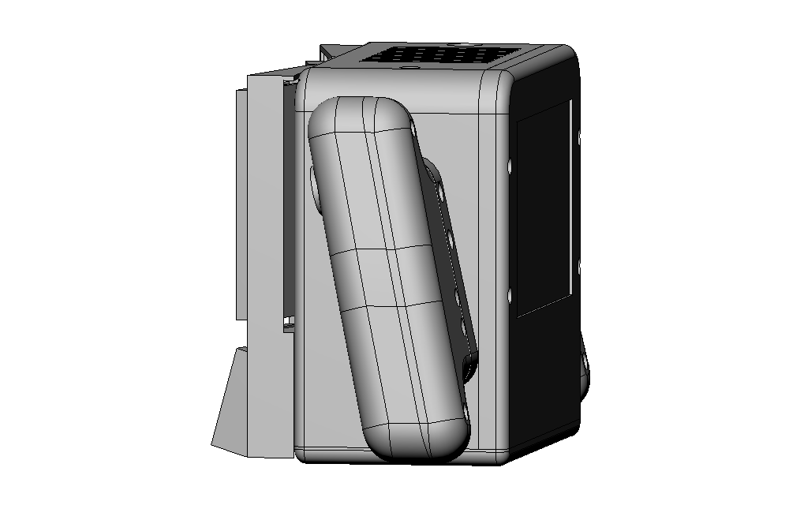
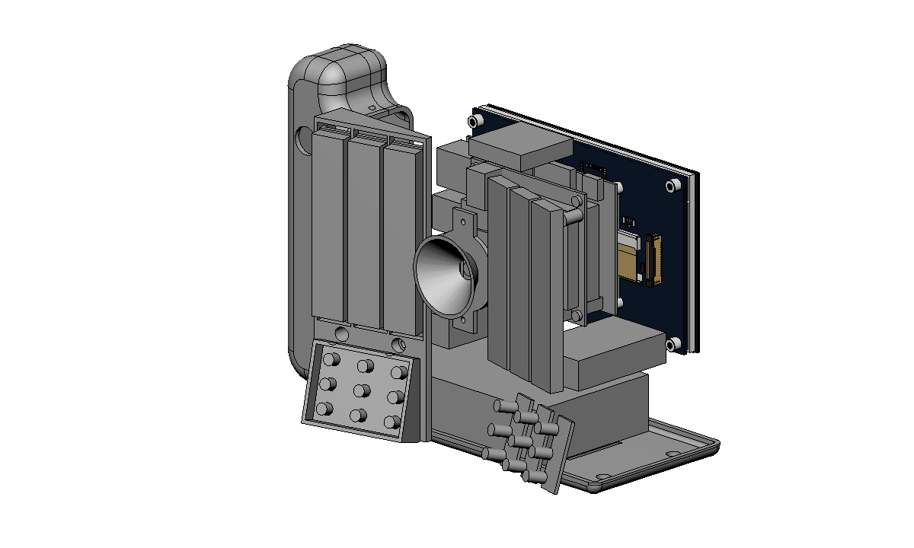
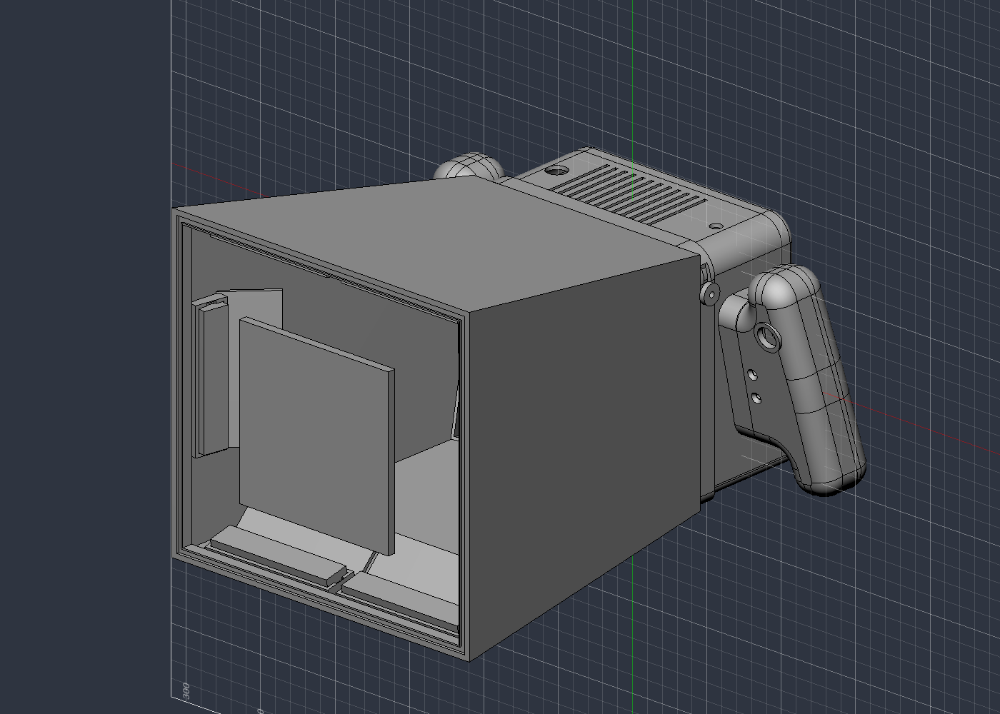
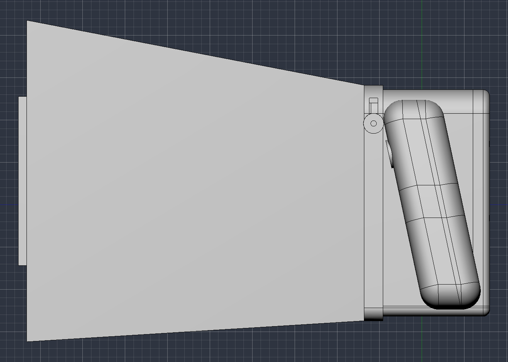
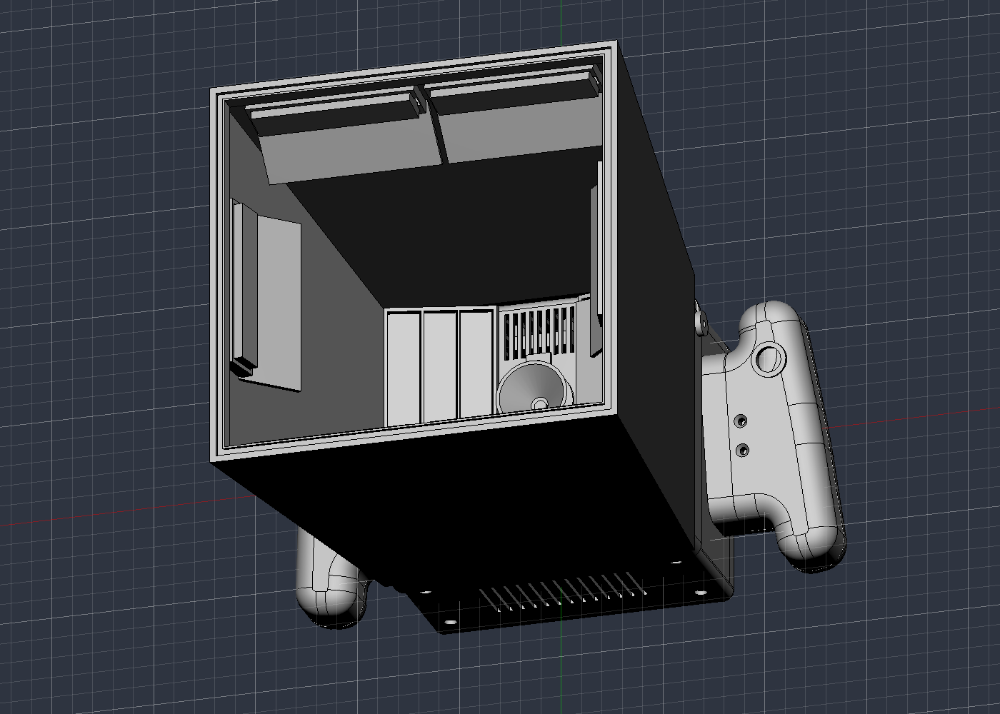

# Ayas handheld enclosure (F1-wheel style)

A 3D-printable, two-hand housing, held by the grips like an F1 steering wheel.

| Faces | What is there |
|---|---|
| **Front** (toward the part) | the Raspberry Pi AI Camera, plus an LED pod on each side. Each pod holds **3 white strips × 3 LEDs** and **3 UV strips × 3 LEDs** |
| **Back** (toward you) | the **Waveshare 5inch DSI LCD (800×480)**, landscape |
| **Inside** | the Raspberry Pi 5 with its Active Cooler and the AI HAT+ 2 (40 TOPS), a USB-PD power bank, a 30 mm fan and the power electronics |






These images are from the Fusion model. The back and inside views include Waveshare's own 3D model of the display, which was imported only for the fit check. The inside view hides the shell, the BackLid, the user's left wing and its LED pod.

## Files

| File | What |
|---|---|
| `ayas_handheld_fusion.py` | The generator. **Every dimension is a parameter in `P` at the top.** Change them and re-run to get a new design. |
| `out/*.stl` | One STL per printed part, in mm |
| `out/Ayas_handheld.step` | The whole assembly, including the reference dummies, for any CAD tool |
| `out/Ayas_handheld.f3d` | Fusion archive (File → Open → Open from my computer) |
| `../../docs/research/2026-11-05_enclosure_*.md` | Sourced dimensions and design rules the model is built from |

**To regenerate in Fusion**, run in Utilities → Scripts, or through the Fusion MCP:

```python
g = {}
exec(open('<repo>/hardware/enclosure/ayas_handheld_fusion.py').read(), g)
g['build']()     # new design + interference check + export to out/
```

Each run opens a **new** design. It prints:
- an interference check of every printed part against the reference dummies (display, Pi stack incl. Active Cooler, HAT heatsink and push pins, camera, power bank, fan, electronics carriers, LEDs);
- the size of each part;
- the plastic weight.

The current build reports **no interference and no stray bodies**. It was also checked against Waveshare's official 3D model of the display (`5inch-dsi-lcd_asm.stp` from files.waveshare.com), imported at its mounted position: no printed part touches it, and the four retaining posts land on its outer standoffs.

**Size:**
- 268 × 140 × 74 mm overall; grips 224 mm centre to centre.
- About **410 g of PETG** with solid walls.
- About **0.98 kg** with all electronics (est.).

## Grip ergonomics

Each value follows the ergonomics research in `docs/research/2026-11-05_enclosure_ergonomics_printing.md`.

| Feature | Value | Why |
|---|---|---|
| **Rake** | The whole wing (arm + grip) leans 12°, bottoms toward you (`grip_rake_deg`) | Holding the device at chest height, the wrists stay straight instead of bending back |
| **Splay** | Grip tops lean 7° inward (`grip_splay_deg`) | Matches the natural angle of the hands on a wheel, like an F1 grip |
| **Palm swell** | 29 mm wide at the ends, 32 mm in the middle | Fills the palm |
| **Section** | Near-oval, 29–32 × 36 mm, all front/back edges rounded R11 | Optimum power-grip diameter is 31–38 mm, and there are no hard edges against the fingers |
| **Length** | 124 mm straight | Clears a P95 Indian adult hand (94 mm) with room to shift grip |
| **Spacing** | 224 mm centre to centre | Closer than an F1 wheel's ~280 mm, so the thumbs reach the screen edges |
| **Thumb buttons** | Two 7 mm buttons per side, on the flat back of the arm root, about 32 mm in from the grip axis | Inside the 30–45 mm thumb-reach band |
| **Index triggers** | 12 mm buttons on a raised flat pad high on each grip front | The pad gives the button a flat seat and is easy to find by feel |
| **Balance** | Grips centred close to the *estimated* centre of mass (the bank sits low, the display high) | The device shouldn't tip forward or back in your hands. Check it on the first print and move `grip_cy` / `slab_zc` if it does |

For extra grip, wrap the grips in 1–2 mm silicone or TPU grip tape (or print TPU 95A pads). To try other angles, change `grip_rake_deg` / `grip_splay_deg` and re-run the generator. Print one wing in PLA first and hold it before committing to PETG.

## Inspection hood (`InspectionHood`, added 22 Nov 2026)

The device only certifies a part with the hood fitted (the 22 Nov hood-only policy): in open mode, daylight causes retakes and misses. The hood is the twin-tested device v2 head (`docs/twin/DESIGN_STEEL.md` C2) made printable.





| Feature | Value | Why |
|---|---|---|
| Collar | Slides over the body front (z 23–34 mm), following its rounded outline with 0.4 mm clearance; 2 × M3 thumb screws into heat-set inserts in FrontCentre's side walls (`hood_screw`) | Light-tight at the rounded corners; clears the grip arms |
| Frustum | 2.2 mm matte-black wall from the body front down to the plate, **200 × 190 mm** at the rim, centred on the optical axis, 200 mm working distance (`hood_wd`) | The geometry the twin's lighting test used |
| LED ring | **6 pockets** for your 78 × 15 mm white 3-LED modules (2 per long wall, 1 per short wall), board face 6 mm off the wall, **18 mm above the plate**, tilted **11.4–12.2° down** at the plate | Low-angle dark-field light: flat metal mirrors it away from the lens, defects scatter it in. Wire the 3 image-left modules to the L channel and the 3 image-right ones to R (`app.yaml part.illumination: ring`) |
| Lips | A 32 mm, 45° lip over each module | The camera must never see an LED. Checked on the model: every module is hidden at both ends and the centre, and every corner of a 150 × 100 mm plate stays in view |
| Rim | 5 mm inward thickening with a 3.2 × 1.6 mm groove | Glue in 3 × 3 mm black EPDM foam as the light seal on the part |
| Wire slots | 10 × 5 mm slot in each collar side wall (`hood_wire`) | Ring wires reach the pod channels |

**Checks on the model (Fusion, 22 Nov):** no interference with any part or dummy; a light-path scan of 24,500 wall points found no openings; LED hiding and plate visibility as above.

**Print:** about 403 cm³ (~510 g PETG), 200 × 190 × 210 mm. That fits a 256 mm bed, or a 220 × 220 × 250 mm bed with little margin. Print **rim-down in black PETG**. Use tree supports only under the 6 module brackets; the 45° lips need none. Paint the inside matte black if the filament is glossy.

**Not yet measured:** your LED modules' size (`white_l`, `white_w`) and the real light leakage. Leakage is the first Phase 2 test, since the twin's hood is light-tight by construction.

## Measure these before printing (CHECK)

The model uses datasheet values. Measure your own parts and change `P` if they differ.

| Parameter | Default | Measure |
|---|---|---|
| `white_l`, `white_w` | 78 × 15 mm | your 12 V 3-LED white module (listings range from 77 × 12.5 to 78 × 15) |
| `display` | `'ws5_dsi'` (Waveshare 5inch DSI LCD 800×480) | Profiles live in `DISPLAYS`. `'td2_5'` is the Raspberry Pi Touch Display 2 5"; it also widens the body to 164 mm. The Waveshare (C) 1024×600 has the same glass but different Pi holes and is not profiled yet |
| `bank`, `bay_*` | Xiaomi Pocket Power Bank Pro 10000 33 W (90 × 63.9 × 24.4) | your bank. It must offer **12 V ≥ 2.5 A on USB-C**. For the Anker Nano 30 W use `bay_l=106, bay_t=28` |
| `tool_hole_d` | 14 mm | the AI Camera's lens tool diameter + 1 mm |
| `m3_insert_d/l` | 4.0 / 6.7 mm | your heat-set inserts (CNC Kitchen / ruthex M3 × 5.7) |
| `pi_usb_dir` | set by the profile | On the Waveshare the Pi fits **only one way round**: USB/Ethernet toward the user's right, GPIO edge down. Turned the other way, the Pi would sit on the display's tall DSI connector |

## Print list

| Part | Qty | Orientation | Supports |
|---|---|---|---|
| FrontCentre | 1 | Front face down | Tree supports under the arm stubs and joint tabs. Part is 192 × 128 mm, so **it needs a bed of about 200 mm or more** (fine on Bambu A1/P1S/X1C, Ender-3 V3, Prusa MK4S; too big for the A1 mini) |
| BackLid | 1 | Display face down | None |
| BayDoor | 1 | Outside face down | None |
| WingFront_L / _R | 2 | Split face down (the split is the raked plane, so it is flat) | Tree supports for the roof; they come out through the open side |
| WingBack_L / _R | 2 | Split face down | As above |
| LedPod_L / _R | 2 | Back (flat) face down | None |
| CamHood | 1 | Flange down | None |

**Material:** **PETG in black**, never PLA.
- PLA softens at about 55 °C; the Pi, the HAT and the LED modules get warm, and Bengaluru reaches 38 °C.
- The pods, hood and front must be black: white or natural plastic glows blue under the UV LEDs and leaks light into the camera.
- ASA is fine for the pods if your printer is enclosed.

**Settings:** 0.2 mm layers, 5 walls (the 2.2 mm walls print solid), 15–20 % gyroid infill, 5 mm brim on the FrontCentre and BackLid. Print one corner as a test piece first and check the insert holes and the display recess.

## Hardware to buy

| Item | Qty | Note |
|---|---|---|
| M3 × 5.7 heat-set inserts (CNC Kitchen / ruthex) | 24 | FrontCentre 20, WingFront 4 |
| M3 × 12 cap screws | 8 | BackLid 4, BayDoor 4 |
| M3 × 8 cap screws | 4 | LED pods |
| M3 × 8 countersunk screws | 8 | wing joint tabs: 4 on the arm fronts, 4 on the arm backs |
| M3 × 16 cap screws | 4 | wing back to wing front (2 per grip) |
| M3 × 8 thread-forming screws | 8 | power-electronics carriers (no inserts there) |
| M3 × 12 self-tapping screws | 4 | 30 mm fan |
| M2 × 5 self-tapping screws | 4 | AI Camera |
| M2 × 6 self-tapping screws | 2 | camera hood |
| M2.5 male-female standoffs, 16 mm | 4 | The Pi's 4 holes are needed by both the display and the HAT. The male end goes through the Pi into the display's 4 mm SMT standoffs; the HAT screws onto the female end. Check the thread depth in the display standoffs first |
| 1 mm foam pads / VHB tape | 1 sheet | on the 4 display posts (they press the display's outer standoffs); on the bezel lip around the glass |
| 12 mm momentary panel buttons | 2 | index-finger triggers on the grip fronts |
| 7 mm momentary panel buttons | 4 | thumb buttons on the back of the arm roots |
| 12 mm latching switch, rated ≥ 3 A | 1 | main power, top (user's right) |
| 6–7 mm momentary button | 1 | wired to the Pi 5 J2 power pads, top (user's left) |
| 30 × 30 × 7 mm 5 V fan | 1 | exhausts up through the top vents |
| 12 V 3-LED white modules | 6 | same family as your blue ones |
| 1 mm aluminium strip | 6 pieces of 78 × 15 mm | heat spreader under each white module |
| 5 mm 395 nm UV LEDs | 18 | you have 50 |
| Perfboard 30.5 × 10.2 mm (12 × 4 holes), 150 Ω ¼ W resistors | 6 boards, 6 resistors | one strip = 3 LEDs in series + 150 Ω from 12 V (about 16 mA) |
| USB-PD trigger fixed at **12 V** (19 × 10 mm class, or ZY12PDN) | 1 | check its output with a meter before connecting anything |
| 5 V 5 A buck (Pololu D36V50F5 / D24V50F5, or a TPS565201 / AP64500 module) | 1 | MINI560-class boards are only about 3 A continuous, which is too weak |
| Logic-level MOSFET channels (AO3400A) | 5 | white L, white R, UV L, UV R, fan |
| 3.15 A slow-blow fuse + 470–1000 µF/25 V capacitor | 1 each | on the 12 V rail |
| Short right-angle USB-C cable | 1 | bank to PD trigger, through the shelf slot |
| Short right-angle USB-C pigtail | 1 | 5 V buck to the Pi's USB-C |
| Raspberry Pi 5 **camera** cable, 200 mm (22→15) | 1 | camera to the Pi |
| Display cable | 1 | Use the Pi 5 DSI cable that came with the Waveshare if it reaches (about 90 mm path from the display's connector, at the user's left, to the Pi). Otherwise buy the official 200 mm Pi 5 **display** cable. Camera and display cables are **not** interchangeable |
| Power bank: Xiaomi Pocket Power Bank Pro 10000 33 W (or another with 12 V 2.5 A on USB-C) | 1 | ordinary 20–22.5 W banks give only 12 V 1.67 A, which is not enough |

## Power and wiring

```
bank USB-C ── 12 V PD trigger ── main switch ── fuse ──┬── 1000 µF ── GND
                                                       ├── 12 V rail ── white L/R, UV L/R (low-side AO3400A, from GPIO)
                                                       └── 5 V 5 A buck ──┬── USB-C pigtail ── Pi 5
                                                                          └── fan (low-side AO3400A, from GPIO)
```

- **Pi power:** set `PSU_MAX_CURRENT=5000` in the Pi EEPROM (`sudo rpi-eeprom-config -e`). Under load, check `vcgencmd pmic_read_adc EXT5V_V` and `vcgencmd get_throttled`.
- **Display:** the Waveshare 5" DSI is powered over its DSI ribbon, so it needs no separate power lead. On the Pi add `dtoverlay=vc4-kms-dsi-7inch` per the Waveshare wiki, and rotate in software if needed.
- **LED duty:** never light all white and all UV at once. Fire one group per capture frame; the peak then stays within the bank's 12 V 2.5 A.
- **UV:** on only while a trigger is held and during capture, with a 2 s software timeout. Put a "UV — do not look into the light" label on the front.
- **Buttons:** use GPIO 13/16/19/20/21/26, avoiding GPIO 0–8. Check whether the AI HAT+ 2's top J1 socket takes jumpers; if it doesn't, solder to the stacking-header pins.

## Assembly order

1. **Inserts:** press all 26 heat-set inserts in with a soldering iron at about 245 °C.
2. **Camera:**
   1. Set focus at about 200 mm with the lens tool on the bench.
   2. Screw the camera to its 4 bosses (M2 × 5) from inside.
   3. Fit the hood (M2 × 6) on the front.
3. **LED pods:**
   1. Put an aluminium strip and a white module in each pocket, wires through the end slots.
   2. Push the UV LEDs in from behind, the flange against the seat, then solder the perfboard.
   3. Screw each pod to the FrontCentre (M3 × 8). The pod's top tongues drop into the wire window.
4. **Inside the FrontCentre:** fit the power-electronics perfboards on the shelf bosses, the fan under the top vents, the main switch and the J2 button.
5. **Display + Pi stack (outside the case):**
   1. Plug the display cable into the display's DSI connector, at the user's-left end of the board, beside the Pi.
   2. Bolt the Pi to the display with the 4 M2.5 male-female 16 mm standoffs: USB/Ethernet toward the user's right, GPIO edge down.
   3. Plug both flat cables into the Pi 5's CAM/DISP connectors.
   4. Fit the AI HAT+ 2 on its header with its own screws.
6. **BackLid:** put VHB tape on the bezel lip, then lay the display + stack face-down into the BackLid.
7. **Close the centre:** fold the camera cable, then lower the FrontCentre over the stack. The 4 foam-tipped posts press the display's 4 outer standoffs, not the HAT. Fit the 4 lid screws (M3 × 12) from the back.
8. **Wings:**
   1. Fit the trigger and thumb buttons and run their wires through the arm.
   2. Slide each WingFront onto the centre tabs; the top/bottom tabs locate it. Fit 2 countersunk screws through the arm front.
   3. Close each WingBack: 2 countersunk screws through the arm back into the centre's back tab, and 2 × M3 × 16 at the grip ends.
9. **Bank:** put the bank in the bay with foam (it is loose by about 12 mm). Plug the right-angle cable through the shelf slot and close the BayDoor (4 × M3 × 12). To charge or swap the bank, open the door.

## Known limits and next steps

- **Heat:** the Pi 5 and AI HAT+ 2 dissipate about 11–16 W, and the HAT is rated to 50 °C ambient. Run a 20-minute stress test (vision + Llama) and log the CPU and Hailo temperatures before relying on it. The fan is not optional.
- **Weight:** about 1.05 kg (est.), at the top of the comfortable range. 2.0 mm walls on the wings and BackLid would save about 25 g. TPU grip sleeves (1.5–2 mm) improve the hold.
- **Touch reach:** with the grips 224 mm apart, thumbs reach about the outer 10–15 mm of the 109 mm-wide visible area while holding the grips. Make the physical buttons the main controls, with on-screen buttons at the screen edges.
- **Lens tool:** its size is unpublished; measure it and set `tool_hole_d`.
- **Lighting geometry:** the lights are 40–80 mm from the lens, so flat shiny parts show a specular hotspot from each strip. Capture one light group per frame and let the software combine them.
