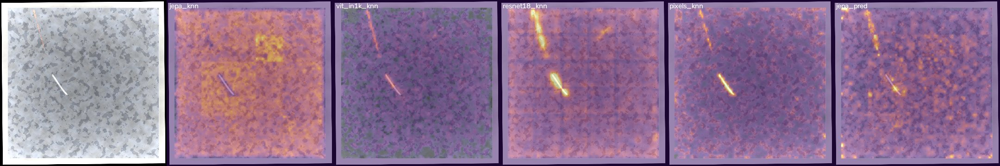
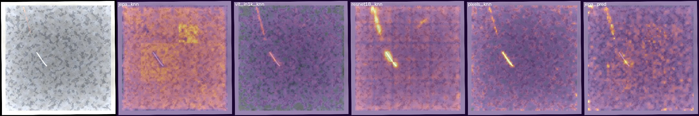
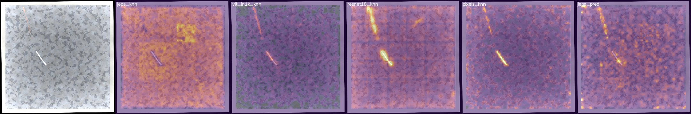
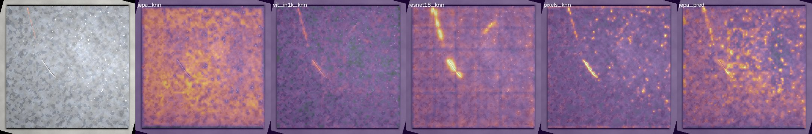

# JEPA anomaly map and lighting invariance: result (twin test plates)

- Test grids scored: 698 (burst-arm RETAKE skipped: 142; unreadable: 0); test plates s900100, s900101, s900102, s900103, s900104, s900105, s900106, s900107, s900108, s900109, s900110, s900111, s900112, s900113, s900124 (seeds >= 900100, never trained on).
- Memory banks (one per arm with training grids): burst 836 accepted grids of training plates s100000, s100001, s100002, s100003, s100004, s100005, s100007, s100008, s100009, s100010, s100011, s100012, s100013, s100014, s100015, s100016, s100017, s100018, s100019, s100020, s100021, s100022, s100023, s100024, s100025, s100026, s100027, s100028, s100029, s100030, s100031, s100032, s100033, s100034, s100035, s100036, s100037, s100038, s100039, s100040, s100041, s100042, s100043, s100044, s100045, s100046, s100047; defect margin 2.0 mm; coreset 10000. The naive arm had no training grids and is scored against the burst-arm bank (a domain mismatch by construction: read its rows with that in mind).
- Scales [1.0, 2.0] (1 = 1.28 mm patches, 2 = 2.56 mm), averaged in z units; device cuda; 1941 s.
- Region level: a defect's max score inside its footprint (+0.5 mm) vs the max of each 64 px (5.1 mm) normal cell (>= 2.0 mm from any defect). recall@0.5FA: threshold at 0.5 false-alarm cells per plate (set on the test normals: an operating point, not a deployable threshold). recall@z3 / FA@z: the fixed threshold z > 3 set from the training bank only (deployable). Only defects visible in the C0 reference count.

## 1. Overview by method, arm and device (result (twin test plates))

| method | arm | device | defects | pixel AUROC | pixel AP | region AUROC | region AP | recall@0.5FA | recall@z3 | FA/plate@z | distractor alarms |
|---|---|---|---|---|---|---|---|---|---|---|---|
| jepa_knn | burst | hood | 518 | 0.340 | 0.353 | 0.508 | 0.014 | 0.02 | 0.54 | 200.25 | 0.39 |
| jepa_knn | burst | open | 213 | 0.372 | 0.413 | 0.563 | 0.010 | 0.01 | 0.49 | 164.68 | 0.29 |
| jepa_knn | naive | hood | 518 | 0.231 | 0.320 | 0.395 | 0.006 | 0.00 | 0.89 | 338.76 | 0.68 |
| jepa_knn | naive | open | 532 | 0.306 | 0.346 | 0.418 | 0.010 | 0.02 | 0.83 | 313.76 | 0.77 |
| jepa_pred | burst | hood | 518 | 0.907 | 0.897 | 0.975 | 0.375 | 0.24 | 0.88 | 21.90 | 0.58 |
| jepa_pred | burst | open | 213 | 0.910 | 0.913 | 0.957 | 0.429 | 0.28 | 0.92 | 59.87 | 0.61 |
| jepa_pred | naive | hood | 518 | 0.838 | 0.829 | 0.934 | 0.203 | 0.16 | 0.97 | 162.97 | 0.84 |
| jepa_pred | naive | open | 532 | 0.788 | 0.732 | 0.885 | 0.047 | 0.03 | 0.99 | 197.13 | 0.87 |
| pixels_knn | burst | hood | 518 | 0.902 | 0.912 | 0.919 | 0.297 | 0.14 | 0.77 | 18.87 | 0.58 |
| pixels_knn | burst | open | 213 | 0.886 | 0.913 | 0.858 | 0.301 | 0.25 | 0.67 | 23.47 | 0.15 |
| pixels_knn | naive | hood | 518 | 0.858 | 0.885 | 0.907 | 0.340 | 0.24 | 0.78 | 33.51 | 0.53 |
| pixels_knn | naive | open | 532 | 0.904 | 0.895 | 0.873 | 0.196 | 0.15 | 0.77 | 59.61 | 0.41 |
| resnet18_knn | burst | hood | 518 | 0.970 | 0.972 | 0.965 | 0.687 | 0.58 | 0.86 | 16.30 | 0.68 |
| resnet18_knn | burst | open | 213 | 0.973 | 0.976 | 0.957 | 0.586 | 0.37 | 0.82 | 7.04 | 0.57 |
| resnet18_knn | naive | hood | 518 | 0.961 | 0.964 | 0.960 | 0.668 | 0.59 | 0.88 | 29.25 | 0.68 |
| resnet18_knn | naive | open | 532 | 0.967 | 0.969 | 0.949 | 0.579 | 0.45 | 0.89 | 33.93 | 0.68 |
| vit_in1k_knn | burst | hood | 518 | 0.894 | 0.901 | 0.919 | 0.564 | 0.50 | 0.04 | 0.00 | 0.00 |
| vit_in1k_knn | burst | open | 213 | 0.914 | 0.933 | 0.923 | 0.655 | 0.56 | 0.07 | 0.00 | 0.00 |
| vit_in1k_knn | naive | hood | 518 | 0.881 | 0.895 | 0.927 | 0.566 | 0.51 | 0.00 | 0.00 | 0.00 |
| vit_in1k_knn | naive | open | 532 | 0.905 | 0.901 | 0.923 | 0.374 | 0.25 | 0.05 | 0.00 | 0.00 |

## 2. Per defect class, region AUROC / pixel AUROC (result (twin test plates))

| method | arm | device | scratch | dent | pit | corrosion | crack | stain |
|---|---|---|---|---|---|---|---|---|
| jepa_knn | burst | hood | 0.63 / 0.35 (n=126) | 0.45 / 0.60 (n=56) | 0.40 / 0.32 (n=98) | 0.37 / 0.14 (n=98) | 0.54 / 0.35 (n=84) | 0.65 / 0.50 (n=56) |
| jepa_knn | burst | open | 0.65 / 0.41 (n=57) | 0.48 / 0.42 (n=24) | 0.48 / 0.50 (n=38) | 0.45 / 0.17 (n=42) | 0.64 / 0.51 (n=34) | 0.71 / 0.55 (n=18) |
| jepa_knn | naive | hood | 0.55 / 0.27 (n=126) | 0.26 / 0.43 (n=56) | 0.17 / 0.11 (n=98) | 0.43 / 0.07 (n=98) | 0.33 / 0.27 (n=84) | 0.59 / 0.36 (n=56) |
| jepa_knn | naive | open | 0.56 / 0.38 (n=126) | 0.34 / 0.31 (n=70) | 0.19 / 0.30 (n=98) | 0.50 / 0.15 (n=98) | 0.35 / 0.31 (n=84) | 0.56 / 0.44 (n=56) |
| jepa_pred | burst | hood | 0.97 / 0.95 (n=126) | 0.98 / 0.80 (n=56) | 0.98 / 0.99 (n=98) | 0.98 / 0.89 (n=98) | 0.95 / 0.94 (n=84) | 0.99 / 0.87 (n=56) |
| jepa_pred | burst | open | 0.93 / 0.90 (n=57) | 0.89 / 0.94 (n=24) | 0.96 / 0.98 (n=38) | 0.99 / 0.90 (n=42) | 1.00 / 0.99 (n=34) | 0.99 / 0.88 (n=18) |
| jepa_pred | naive | hood | 0.94 / 0.90 (n=126) | 0.76 / 0.66 (n=56) | 0.95 / 0.95 (n=98) | 0.97 / 0.82 (n=98) | 0.96 / 0.95 (n=84) | 0.97 / 0.77 (n=56) |
| jepa_pred | naive | open | 0.89 / 0.83 (n=126) | 0.89 / 0.84 (n=70) | 0.83 / 0.91 (n=98) | 0.93 / 0.69 (n=98) | 0.93 / 0.95 (n=84) | 0.83 / 0.71 (n=56) |
| pixels_knn | burst | hood | 0.98 / 0.95 (n=126) | 0.85 / 0.91 (n=56) | 0.81 / 0.98 (n=98) | 0.99 / 0.96 (n=98) | 0.92 / 0.88 (n=84) | 0.92 / 0.65 (n=56) |
| pixels_knn | burst | open | 0.89 / 0.89 (n=57) | 0.74 / 0.73 (n=24) | 0.74 / 0.97 (n=38) | 1.00 / 0.97 (n=42) | 0.83 / 0.92 (n=34) | 0.89 / 0.75 (n=18) |
| pixels_knn | naive | hood | 0.95 / 0.94 (n=126) | 0.91 / 0.93 (n=56) | 0.80 / 0.98 (n=98) | 0.98 / 0.85 (n=98) | 0.88 / 0.84 (n=84) | 0.91 / 0.59 (n=56) |
| pixels_knn | naive | open | 0.95 / 0.94 (n=126) | 0.82 / 0.81 (n=70) | 0.70 / 0.98 (n=98) | 0.95 / 0.94 (n=98) | 0.93 / 0.96 (n=84) | 0.84 / 0.81 (n=56) |
| resnet18_knn | burst | hood | 1.00 / 0.99 (n=126) | 0.97 / 0.97 (n=56) | 0.88 / 0.99 (n=98) | 1.00 / 0.99 (n=98) | 0.99 / 0.99 (n=84) | 0.94 / 0.86 (n=56) |
| resnet18_knn | burst | open | 0.99 / 0.98 (n=57) | 0.89 / 0.97 (n=24) | 0.86 / 0.99 (n=38) | 1.00 / 0.99 (n=42) | 1.00 / 1.00 (n=34) | 0.98 / 0.91 (n=18) |
| resnet18_knn | naive | hood | 1.00 / 0.99 (n=126) | 0.98 / 0.97 (n=56) | 0.87 / 0.99 (n=98) | 1.00 / 0.96 (n=98) | 0.98 / 0.99 (n=84) | 0.92 / 0.87 (n=56) |
| resnet18_knn | naive | open | 0.99 / 0.99 (n=126) | 0.94 / 0.98 (n=70) | 0.80 / 0.99 (n=98) | 0.99 / 0.98 (n=98) | 1.00 / 1.00 (n=84) | 0.96 / 0.87 (n=56) |
| vit_in1k_knn | burst | hood | 1.00 / 0.95 (n=126) | 0.69 / 0.78 (n=56) | 0.78 / 0.86 (n=98) | 0.99 / 0.90 (n=98) | 0.99 / 0.95 (n=84) | 1.00 / 0.85 (n=56) |
| vit_in1k_knn | burst | open | 0.98 / 0.90 (n=57) | 0.90 / 0.73 (n=24) | 0.66 / 0.98 (n=38) | 1.00 / 0.97 (n=42) | 1.00 / 0.99 (n=34) | 1.00 / 0.92 (n=18) |
| vit_in1k_knn | naive | hood | 0.99 / 0.96 (n=126) | 0.81 / 0.81 (n=56) | 0.76 / 0.89 (n=98) | 0.99 / 0.82 (n=98) | 1.00 / 0.96 (n=84) | 0.99 / 0.86 (n=56) |
| vit_in1k_knn | naive | open | 0.98 / 0.93 (n=126) | 0.92 / 0.84 (n=70) | 0.70 / 0.88 (n=98) | 0.99 / 0.94 (n=98) | 0.98 / 0.98 (n=84) | 0.98 / 0.85 (n=56) |

## 3. Per lighting condition, region AUROC (result (twin test plates))

| method | arm | device | C0 | C1 | C2 | C3 | C4 | C5 | C6 |
|---|---|---|---|---|---|---|---|---|---|
| jepa_knn | burst | hood | 0.52 | 0.50 | 0.50 | 0.51 | 0.51 | 0.51 | 0.51 |
| jepa_knn | burst | open | 0.55 | 0.57 | 0.52 | 0.66 | 0.75 | 0.58 | – |
| jepa_knn | naive | hood | 0.39 | 0.39 | 0.39 | 0.40 | 0.40 | 0.39 | 0.39 |
| jepa_knn | naive | open | 0.45 | 0.42 | 0.43 | 0.40 | 0.42 | 0.40 | 0.41 |
| jepa_pred | burst | hood | 0.97 | 0.98 | 0.97 | 0.98 | 0.98 | 0.98 | 0.98 |
| jepa_pred | burst | open | 0.97 | 0.95 | 0.96 | 0.93 | 0.97 | 0.92 | – |
| jepa_pred | naive | hood | 0.93 | 0.93 | 0.93 | 0.93 | 0.93 | 0.93 | 0.93 |
| jepa_pred | naive | open | 0.91 | 0.89 | 0.86 | 0.92 | 0.86 | 0.88 | 0.89 |
| pixels_knn | burst | hood | 0.92 | 0.92 | 0.92 | 0.92 | 0.92 | 0.92 | 0.92 |
| pixels_knn | burst | open | 0.87 | 0.90 | 0.84 | 0.82 | 0.88 | 0.84 | – |
| pixels_knn | naive | hood | 0.91 | 0.91 | 0.91 | 0.91 | 0.91 | 0.91 | 0.91 |
| pixels_knn | naive | open | 0.87 | 0.86 | 0.87 | 0.89 | 0.89 | 0.85 | 0.88 |
| resnet18_knn | burst | hood | 0.96 | 0.97 | 0.96 | 0.97 | 0.96 | 0.96 | 0.97 |
| resnet18_knn | burst | open | 0.96 | 0.96 | 0.95 | 0.96 | 1.00 | 0.93 | – |
| resnet18_knn | naive | hood | 0.96 | 0.96 | 0.96 | 0.96 | 0.96 | 0.96 | 0.96 |
| resnet18_knn | naive | open | 0.95 | 0.94 | 0.95 | 0.95 | 0.95 | 0.95 | 0.95 |
| vit_in1k_knn | burst | hood | 0.91 | 0.92 | 0.92 | 0.92 | 0.92 | 0.92 | 0.92 |
| vit_in1k_knn | burst | open | 0.93 | 0.90 | 0.92 | 0.97 | 0.92 | 0.95 | – |
| vit_in1k_knn | naive | hood | 0.93 | 0.93 | 0.93 | 0.93 | 0.93 | 0.93 | 0.92 |
| vit_in1k_knn | naive | open | 0.94 | 0.93 | 0.93 | 0.93 | 0.90 | 0.92 | 0.92 |

## 4. Per material, region AUROC (result (twin test plates))

| method | arm | aluminium | galvanised | ms_cold_rolled | ms_hot_rolled | ss_2b | ss_brushed |
|---|---|---|---|---|---|---|---|
| jepa_knn | burst | 0.33 | – | 0.48 | 0.59 | 0.67 | 0.66 |
| jepa_knn | naive | 0.53 | – | 0.26 | 0.40 | 0.48 | 0.35 |
| jepa_pred | burst | 1.00 | – | 1.00 | 0.93 | 1.00 | 0.99 |
| jepa_pred | naive | 0.97 | – | 0.99 | 0.84 | 0.98 | 0.99 |
| pixels_knn | burst | 0.93 | – | 0.96 | 0.87 | 0.99 | 0.97 |
| pixels_knn | naive | 0.95 | – | 0.99 | 0.84 | 0.98 | 0.94 |
| resnet18_knn | burst | 0.97 | – | 1.00 | 0.98 | 1.00 | 0.98 |
| resnet18_knn | naive | 0.94 | – | 1.00 | 0.99 | 0.99 | 0.97 |
| vit_in1k_knn | burst | 0.88 | – | 1.00 | 0.92 | 1.00 | 0.92 |
| vit_in1k_knn | naive | 0.82 | – | 1.00 | 0.93 | 0.98 | 0.94 |

## 5. Lighting invariance vs C0 of the same device (result (twin test plates))

Scale-1 patch embeddings, centred by the training-bank mean of each extractor. cos same = the patch vs itself under C0; cos other = vs a random other patch of the window (the floor); retrieval@1 = the patch's nearest C0 patch in its window (196 candidates) is itself. Accepted captures only (burst RETAKE rows dropped; the naive arm has no gate). Higher retrieval@1 and gap = more invariant AND still discriminative.

**retrieval_at1**

| extractor | arm | device | C1 | C2 | C3 | C4 | C5 | C6 | mean |
|---|---|---|---|---|---|---|---|---|---|
| jepa | burst | hood | 0.932 | 0.932 | 0.932 | 0.931 | 0.930 | 0.931 | 0.931 |
| jepa | burst | open | 0.853 | 0.815 | 0.814 | 0.871 | 0.914 | – | 0.853 |
| jepa | naive | hood | 1.000 | 1.000 | 1.000 | 1.000 | 1.000 | 0.990 | 0.998 |
| jepa | naive | open | 0.605 | 0.489 | 0.475 | 0.495 | 0.372 | 0.147 | 0.431 |
| pixels | burst | hood | 0.972 | 0.972 | 0.972 | 0.972 | 0.972 | 0.972 | 0.972 |
| pixels | burst | open | 0.906 | 0.877 | 0.920 | 0.902 | 0.921 | – | 0.905 |
| pixels | naive | hood | 0.995 | 0.995 | 0.995 | 0.995 | 0.995 | 0.995 | 0.995 |
| pixels | naive | open | 0.798 | 0.851 | 0.721 | 0.702 | 0.616 | 0.288 | 0.663 |
| resnet18 | burst | hood | 0.990 | 0.991 | 0.990 | 0.990 | 0.991 | 0.990 | 0.990 |
| resnet18 | burst | open | 0.945 | 0.935 | 0.978 | 0.979 | 0.996 | – | 0.967 |
| resnet18 | naive | hood | 1.000 | 1.000 | 1.000 | 1.000 | 1.000 | 0.997 | 1.000 |
| resnet18 | naive | open | 0.913 | 0.984 | 0.886 | 0.959 | 0.777 | 0.643 | 0.860 |
| vit_in1k | burst | hood | 0.735 | 0.741 | 0.742 | 0.735 | 0.735 | 0.739 | 0.738 |
| vit_in1k | burst | open | 0.659 | 0.674 | 0.544 | 0.683 | 0.669 | – | 0.645 |
| vit_in1k | naive | hood | 1.000 | 1.000 | 1.000 | 1.000 | 1.000 | 0.973 | 0.995 |
| vit_in1k | naive | open | 0.768 | 0.829 | 0.455 | 0.676 | 0.482 | 0.103 | 0.552 |

**gap**

| extractor | arm | device | C1 | C2 | C3 | C4 | C5 | C6 | mean |
|---|---|---|---|---|---|---|---|---|---|
| jepa | burst | hood | 0.283 | 0.284 | 0.284 | 0.284 | 0.283 | 0.284 | 0.284 |
| jepa | burst | open | 0.280 | 0.260 | 0.297 | 0.305 | 0.326 | – | 0.294 |
| jepa | naive | hood | 0.323 | 0.323 | 0.325 | 0.323 | 0.323 | 0.323 | 0.323 |
| jepa | naive | open | 0.253 | 0.223 | 0.231 | 0.209 | 0.210 | 0.133 | 0.210 |
| pixels | burst | hood | 0.419 | 0.419 | 0.422 | 0.420 | 0.417 | 0.420 | 0.419 |
| pixels | burst | open | 0.240 | 0.211 | 0.202 | 0.185 | 0.275 | – | 0.223 |
| pixels | naive | hood | 0.623 | 0.623 | 0.623 | 0.622 | 0.623 | 0.625 | 0.623 |
| pixels | naive | open | 0.335 | 0.342 | 0.318 | 0.294 | 0.280 | 0.189 | 0.293 |
| resnet18 | burst | hood | 0.505 | 0.507 | 0.507 | 0.507 | 0.506 | 0.508 | 0.507 |
| resnet18 | burst | open | 0.511 | 0.491 | 0.520 | 0.512 | 0.563 | – | 0.520 |
| resnet18 | naive | hood | 0.510 | 0.507 | 0.511 | 0.509 | 0.510 | 0.508 | 0.509 |
| resnet18 | naive | open | 0.494 | 0.504 | 0.458 | 0.488 | 0.447 | 0.360 | 0.458 |
| vit_in1k | burst | hood | 0.519 | 0.522 | 0.522 | 0.520 | 0.519 | 0.521 | 0.520 |
| vit_in1k | burst | open | 0.473 | 0.470 | 0.415 | 0.474 | 0.485 | – | 0.464 |
| vit_in1k | naive | hood | 0.742 | 0.741 | 0.739 | 0.741 | 0.742 | 0.714 | 0.736 |
| vit_in1k | naive | open | 0.485 | 0.492 | 0.317 | 0.416 | 0.347 | 0.134 | 0.365 |

**cos_same**

| extractor | arm | device | C1 | C2 | C3 | C4 | C5 | C6 | mean |
|---|---|---|---|---|---|---|---|---|---|
| jepa | burst | hood | 0.986 | 0.986 | 0.986 | 0.985 | 0.985 | 0.985 | 0.985 |
| jepa | burst | open | 0.967 | 0.953 | 0.952 | 0.970 | 0.983 | – | 0.965 |
| jepa | naive | hood | 1.000 | 1.000 | 1.000 | 1.000 | 1.000 | 0.995 | 0.999 |
| jepa | naive | open | 0.817 | 0.778 | 0.751 | 0.758 | 0.678 | 0.472 | 0.709 |
| pixels | burst | hood | 0.968 | 0.969 | 0.968 | 0.968 | 0.968 | 0.968 | 0.968 |
| pixels | burst | open | 0.978 | 0.984 | 0.974 | 0.982 | 0.962 | – | 0.976 |
| pixels | naive | hood | 1.000 | 1.000 | 1.000 | 1.000 | 1.000 | 0.997 | 1.000 |
| pixels | naive | open | 0.946 | 0.973 | 0.836 | 0.857 | 0.795 | 0.352 | 0.793 |
| resnet18 | burst | hood | 0.963 | 0.964 | 0.964 | 0.964 | 0.964 | 0.964 | 0.964 |
| resnet18 | burst | open | 0.922 | 0.922 | 0.906 | 0.928 | 0.935 | – | 0.923 |
| resnet18 | naive | hood | 1.000 | 1.000 | 1.000 | 1.000 | 1.000 | 0.996 | 0.999 |
| resnet18 | naive | open | 0.943 | 0.970 | 0.896 | 0.948 | 0.855 | 0.705 | 0.886 |
| vit_in1k | burst | hood | 0.764 | 0.768 | 0.767 | 0.764 | 0.764 | 0.766 | 0.766 |
| vit_in1k | burst | open | 0.712 | 0.741 | 0.615 | 0.730 | 0.687 | – | 0.697 |
| vit_in1k | naive | hood | 1.000 | 1.000 | 0.998 | 0.999 | 1.000 | 0.968 | 0.994 |
| vit_in1k | naive | open | 0.802 | 0.826 | 0.584 | 0.719 | 0.599 | 0.278 | 0.635 |

## 6. Example heat maps (result (twin test plates))

Left: the canonical burst-arm grid; then one overlay per method (z from -1 to 5, inferno).






## Bank statistics

```json
{
 "burst:jepa_knn@1": {
  "coreset": 10000,
  "pool": 120000,
  "mu": 7.2361,
  "sigma": 1.4283
 },
 "burst:vit_in1k_knn@1": {
  "coreset": 10000,
  "pool": 120000,
  "mu": 43.7084,
  "sigma": 4.1263
 },
 "burst:resnet18_knn@1": {
  "coreset": 10000,
  "pool": 120000,
  "mu": 9.2143,
  "sigma": 1.3673
 },
 "burst:pixels_knn@1": {
  "coreset": 10000,
  "pool": 120000,
  "mu": 4.8275,
  "sigma": 1.0845
 },
 "burst:jepa_pred@1": {
  "mu": 0.19861578941345215,
  "sigma": 0.1548529714345932,
  "n": 120000
 },
 "burst:jepa_knn@2": {
  "coreset": 10000,
  "pool": 120000,
  "mu": 5.6562,
  "sigma": 1.5603
 },
 "burst:vit_in1k_knn@2": {
  "coreset": 10000,
  "pool": 120000,
  "mu": 39.5548,
  "sigma": 6.8232
 },
 "burst:resnet18_knn@2": {
  "coreset": 10000,
  "pool": 120000,
  "mu": 7.8929,
  "sigma": 2.0304
 },
 "burst:pixels_knn@2": {
  "coreset": 10000,
  "pool": 120000,
  "mu": 4.2952,
  "sigma": 1.4012
 },
 "burst:jepa_pred@2": {
  "mu": 0.19973745942115784,
  "sigma": 0.13854198157787323,
  "n": 120000
 }
}
```
