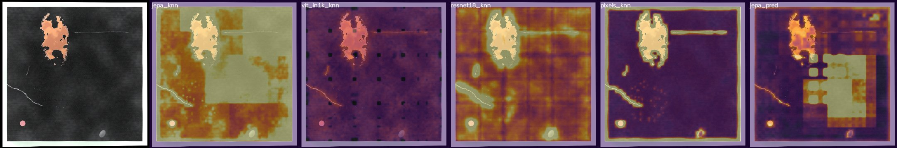
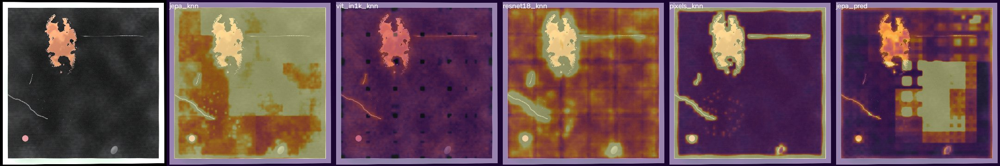
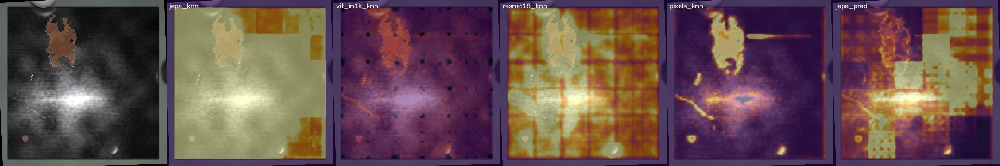

# JEPA anomaly map and lighting invariance: SMOKE, NOT A RESULT

> **SMOKE, NOT A RESULT.** This run only proves the pipeline end to end. The JEPA was trained for 2000 steps on 2 low-resolution TRAINING plates (s100000, s100001; rendered at res-scale 0.5, 32 spp), and the memory bank comes from the same plates, while the test plates are the full-resolution pilot (a resolution domain shift on top of a tiny bank). The test set is 4 plates with a handful of defects per class. None of these numbers says anything about the method; the full training waits for the paired training renders (docs/JEPA.md, data plan).

- Test grids scored: 185 (burst-arm RETAKE skipped: 39; unreadable: 0); test plates s900011, s900027, s900028, s900068 (seeds >= 900000, never trained on).
- Memory bank: 47 accepted burst-arm grids of training plates s100000, s100001; defect margin 2.0 mm; coreset 4000. The naive-arm test grids are scored against the same burst-arm bank (no naive training grids in this run: a domain mismatch by construction).
- Scales [1.0, 2.0] (1 = 1.28 mm patches, 2 = 2.56 mm), averaged in z units; device mps; 2365 s.
- Region level: a defect's max score inside its footprint (+0.5 mm) vs the max of each 64 px (5.1 mm) normal cell (>= 2.0 mm from any defect). recall@0.5FA: threshold at 0.5 false-alarm cells per plate (set on the test normals: an operating point, not a deployable threshold). recall@z3 / FA@z: the fixed threshold z > 3 set from the training bank only (deployable). Only defects visible in the C0 reference count.

## 1. Overview by method, arm and device (SMOKE, NOT A RESULT)

| method | arm | device | defects | pixel AUROC | pixel AP | region AUROC | region AP | recall@0.5FA | recall@z3 | FA/plate@z | distractor alarms |
|---|---|---|---|---|---|---|---|---|---|---|---|
| jepa_knn | burst | hood | 210 | 0.718 | 0.731 | 0.820 | 0.085 | 0.07 | 1.00 | 310.48 | 1.00 |
| jepa_knn | burst | open | 63 | 0.645 | 0.602 | 0.677 | 0.019 | 0.00 | 1.00 | 303.71 | 1.00 |
| jepa_knn | naive | hood | 210 | 0.654 | 0.634 | 0.784 | 0.034 | 0.00 | 1.00 | 311.00 | 1.00 |
| jepa_knn | naive | open | 196 | 0.587 | 0.520 | 0.630 | 0.014 | 0.00 | 1.00 | 308.48 | 1.00 |
| jepa_pred | burst | hood | 210 | 0.713 | 0.688 | 0.747 | 0.030 | 0.00 | 0.56 | 52.05 | 0.38 |
| jepa_pred | burst | open | 63 | 0.682 | 0.665 | 0.657 | 0.024 | 0.00 | 0.43 | 80.12 | 0.56 |
| jepa_pred | naive | hood | 210 | 0.712 | 0.635 | 0.737 | 0.023 | 0.00 | 0.72 | 97.73 | 0.50 |
| jepa_pred | naive | open | 196 | 0.544 | 0.496 | 0.552 | 0.012 | 0.00 | 0.60 | 160.93 | 0.76 |
| pixels_knn | burst | hood | 210 | 0.886 | 0.916 | 0.917 | 0.433 | 0.34 | 0.87 | 119.16 | 0.67 |
| pixels_knn | burst | open | 63 | 0.937 | 0.945 | 0.919 | 0.579 | 0.46 | 0.90 | 87.76 | 0.74 |
| pixels_knn | naive | hood | 210 | 0.817 | 0.877 | 0.891 | 0.583 | 0.47 | 0.93 | 140.16 | 0.83 |
| pixels_knn | naive | open | 196 | 0.899 | 0.902 | 0.919 | 0.176 | 0.12 | 0.93 | 100.88 | 0.80 |
| resnet18_knn | burst | hood | 210 | 0.934 | 0.952 | 0.969 | 0.719 | 0.61 | 1.00 | 247.86 | 1.00 |
| resnet18_knn | burst | open | 63 | 0.911 | 0.934 | 0.964 | 0.570 | 0.49 | 1.00 | 290.53 | 1.00 |
| resnet18_knn | naive | hood | 210 | 0.926 | 0.945 | 0.966 | 0.508 | 0.20 | 1.00 | 294.79 | 1.00 |
| resnet18_knn | naive | open | 196 | 0.937 | 0.953 | 0.985 | 0.723 | 0.63 | 1.00 | 308.57 | 1.00 |
| vit_in1k_knn | burst | hood | 210 | 0.887 | 0.913 | 0.871 | 0.352 | 0.26 | 0.00 | 0.00 | 0.00 |
| vit_in1k_knn | burst | open | 63 | 0.849 | 0.883 | 0.904 | 0.229 | 0.13 | 0.00 | 0.00 | 0.00 |
| vit_in1k_knn | naive | hood | 210 | 0.829 | 0.875 | 0.879 | 0.332 | 0.20 | 0.00 | 0.00 | 0.00 |
| vit_in1k_knn | naive | open | 196 | 0.889 | 0.906 | 0.927 | 0.282 | 0.20 | 0.00 | 0.00 | 0.00 |

## 2. Per defect class, region AUROC / pixel AUROC (SMOKE, NOT A RESULT)

| method | arm | device | scratch | dent | pit | corrosion | crack | stain |
|---|---|---|---|---|---|---|---|---|
| jepa_knn | burst | hood | 0.85 / 0.87 (n=56) | 0.77 / 0.65 (n=42) | 0.97 / 0.99 (n=42) | 0.85 / 0.63 (n=28) | 0.65 / 0.60 (n=42) | – |
| jepa_knn | burst | open | 0.73 / 0.67 (n=20) | 0.51 / 0.44 (n=14) | 0.51 / 0.52 (n=8) | 0.56 / 0.51 (n=4) | 0.86 / 0.87 (n=17) | – |
| jepa_knn | naive | hood | 0.82 / 0.72 (n=56) | 0.73 / 0.59 (n=42) | 0.79 / 0.95 (n=42) | 0.69 / 0.54 (n=28) | 0.85 / 0.68 (n=42) | – |
| jepa_knn | naive | open | 0.66 / 0.62 (n=56) | 0.57 / 0.56 (n=42) | 0.68 / 0.68 (n=42) | 0.42 / 0.45 (n=14) | 0.67 / 0.63 (n=42) | – |
| jepa_pred | burst | hood | 0.69 / 0.66 (n=56) | 0.65 / 0.65 (n=42) | 0.86 / 0.87 (n=42) | 0.96 / 0.89 (n=28) | 0.67 / 0.62 (n=42) | – |
| jepa_pred | burst | open | 0.70 / 0.62 (n=20) | 0.53 / 0.56 (n=14) | 0.22 / 0.23 (n=8) | 0.91 / 0.92 (n=4) | 0.86 / 0.83 (n=17) | – |
| jepa_pred | naive | hood | 0.66 / 0.72 (n=56) | 0.75 / 0.56 (n=42) | 0.68 / 0.71 (n=42) | 0.76 / 0.73 (n=28) | 0.87 / 0.85 (n=42) | – |
| jepa_pred | naive | open | 0.50 / 0.48 (n=56) | 0.55 / 0.53 (n=42) | 0.41 / 0.41 (n=42) | 0.72 / 0.76 (n=14) | 0.72 / 0.57 (n=42) | – |
| pixels_knn | burst | hood | 0.89 / 0.92 (n=56) | 0.84 / 0.70 (n=42) | 0.98 / 0.99 (n=42) | 1.00 / 0.96 (n=28) | 0.91 / 0.94 (n=42) | – |
| pixels_knn | burst | open | 0.89 / 0.94 (n=20) | 0.89 / 0.88 (n=14) | 0.95 / 0.96 (n=8) | 1.00 / 1.00 (n=4) | 0.94 / 0.96 (n=17) | – |
| pixels_knn | naive | hood | 0.88 / 0.84 (n=56) | 0.79 / 0.66 (n=42) | 1.00 / 1.00 (n=42) | 1.00 / 0.89 (n=28) | 0.82 / 0.84 (n=42) | – |
| pixels_knn | naive | open | 0.93 / 0.90 (n=56) | 0.84 / 0.80 (n=42) | 0.95 / 0.97 (n=42) | 0.98 / 0.99 (n=14) | 0.93 / 0.94 (n=42) | – |
| resnet18_knn | burst | hood | 0.93 / 0.83 (n=56) | 1.00 / 1.00 (n=42) | 0.95 / 1.00 (n=42) | 1.00 / 0.95 (n=28) | 1.00 / 0.96 (n=42) | – |
| resnet18_knn | burst | open | 0.98 / 0.84 (n=20) | 0.90 / 0.90 (n=14) | 0.96 / 0.99 (n=8) | 1.00 / 1.00 (n=4) | 0.99 / 0.97 (n=17) | – |
| resnet18_knn | naive | hood | 0.94 / 0.83 (n=56) | 0.99 / 1.00 (n=42) | 0.93 / 0.99 (n=42) | 1.00 / 0.93 (n=28) | 0.99 / 0.95 (n=42) | – |
| resnet18_knn | naive | open | 0.96 / 0.82 (n=56) | 0.99 / 1.00 (n=42) | 0.99 / 1.00 (n=42) | 1.00 / 1.00 (n=14) | 1.00 / 0.98 (n=42) | – |
| vit_in1k_knn | burst | hood | 0.96 / 0.90 (n=56) | 0.85 / 0.94 (n=42) | 0.67 / 0.96 (n=42) | 0.88 / 0.77 (n=28) | 0.97 / 0.93 (n=42) | – |
| vit_in1k_knn | burst | open | 0.96 / 0.82 (n=20) | 0.84 / 0.76 (n=14) | 0.70 / 0.94 (n=8) | 0.93 / 0.83 (n=4) | 0.98 / 0.95 (n=17) | – |
| vit_in1k_knn | naive | hood | 0.99 / 0.89 (n=56) | 0.91 / 0.91 (n=42) | 0.62 / 0.92 (n=42) | 0.87 / 0.60 (n=28) | 0.98 / 0.88 (n=42) | – |
| vit_in1k_knn | naive | open | 0.96 / 0.83 (n=56) | 0.90 / 0.93 (n=42) | 0.86 / 0.97 (n=42) | 0.86 / 0.75 (n=14) | 0.99 / 0.97 (n=42) | – |

## 3. Per lighting condition, region AUROC (SMOKE, NOT A RESULT)

| method | arm | device | C0 | C1 | C2 | C3 | C4 | C5 | C6 |
|---|---|---|---|---|---|---|---|---|---|
| jepa_knn | burst | hood | 0.82 | 0.82 | 0.82 | 0.82 | 0.82 | 0.81 | 0.83 |
| jepa_knn | burst | open | 0.69 | 0.71 | 0.60 | – | – | 0.77 | – |
| jepa_knn | naive | hood | 0.79 | 0.79 | 0.79 | 0.79 | 0.79 | 0.79 | 0.76 |
| jepa_knn | naive | open | 0.67 | 0.63 | 0.67 | 0.62 | 0.61 | 0.61 | 0.60 |
| jepa_pred | burst | hood | 0.75 | 0.74 | 0.75 | 0.74 | 0.74 | 0.74 | 0.76 |
| jepa_pred | burst | open | 0.62 | 0.69 | 0.65 | – | – | 0.75 | – |
| jepa_pred | naive | hood | 0.74 | 0.74 | 0.74 | 0.74 | 0.74 | 0.74 | 0.73 |
| jepa_pred | naive | open | 0.65 | 0.59 | 0.61 | 0.47 | 0.50 | 0.53 | 0.53 |
| pixels_knn | burst | hood | 0.92 | 0.92 | 0.92 | 0.92 | 0.92 | 0.92 | 0.92 |
| pixels_knn | burst | open | 0.92 | 0.96 | 0.92 | – | – | 0.92 | – |
| pixels_knn | naive | hood | 0.89 | 0.89 | 0.89 | 0.89 | 0.89 | 0.89 | 0.88 |
| pixels_knn | naive | open | 0.95 | 0.94 | 0.92 | 0.92 | 0.93 | 0.89 | 0.87 |
| resnet18_knn | burst | hood | 0.97 | 0.97 | 0.97 | 0.97 | 0.97 | 0.97 | 0.97 |
| resnet18_knn | burst | open | 0.98 | 0.99 | 0.92 | – | – | 1.00 | – |
| resnet18_knn | naive | hood | 0.97 | 0.97 | 0.97 | 0.97 | 0.97 | 0.97 | 0.96 |
| resnet18_knn | naive | open | 0.98 | 0.98 | 0.98 | 0.99 | 0.98 | 0.99 | 0.99 |
| vit_in1k_knn | burst | hood | 0.87 | 0.87 | 0.86 | 0.87 | 0.88 | 0.88 | 0.87 |
| vit_in1k_knn | burst | open | 0.91 | 0.92 | 0.92 | – | – | 0.90 | – |
| vit_in1k_knn | naive | hood | 0.88 | 0.88 | 0.88 | 0.88 | 0.88 | 0.88 | 0.87 |
| vit_in1k_knn | naive | open | 0.95 | 0.94 | 0.94 | 0.92 | 0.95 | 0.90 | 0.88 |

## 4. Per material, region AUROC (SMOKE, NOT A RESULT)

| method | arm | aluminium | ms_cold_rolled | ms_hot_rolled | ss_brushed |
|---|---|---|---|---|---|
| jepa_knn | burst | 0.70 | 0.81 | 0.73 | 0.92 |
| jepa_knn | naive | 0.62 | 0.68 | 0.75 | 0.78 |
| jepa_pred | burst | 0.81 | 0.65 | 0.72 | 0.88 |
| jepa_pred | naive | 0.65 | 0.74 | 0.58 | 0.69 |
| pixels_knn | burst | 0.88 | 0.98 | 0.90 | 0.97 |
| pixels_knn | naive | 0.91 | 1.00 | 0.85 | 0.99 |
| resnet18_knn | burst | 0.97 | 0.99 | 0.99 | 1.00 |
| resnet18_knn | naive | 1.00 | 0.98 | 0.98 | 1.00 |
| vit_in1k_knn | burst | 0.95 | 1.00 | 0.76 | 0.53 |
| vit_in1k_knn | naive | 0.98 | 1.00 | 0.82 | 0.73 |

## 5. Lighting invariance vs C0 of the same device (SMOKE, NOT A RESULT)

Scale-1 patch embeddings, centred by the training-bank mean of each extractor. cos same = the patch vs itself under C0; cos other = vs a random other patch of the window (the floor); retrieval@1 = the patch's nearest C0 patch in its window (196 candidates) is itself. Accepted captures only (burst RETAKE rows dropped; the naive arm has no gate). Higher retrieval@1 and gap = more invariant AND still discriminative.

**retrieval_at1**

| extractor | arm | device | C1 | C2 | C3 | C4 | C5 | C6 | mean |
|---|---|---|---|---|---|---|---|---|---|
| jepa | burst | hood | 0.939 | 0.938 | 0.934 | 0.934 | 0.938 | 0.900 | 0.931 |
| jepa | burst | open | 0.844 | 0.444 | – | – | 0.833 | – | 0.707 |
| jepa | naive | hood | 1.000 | 1.000 | 1.000 | 1.000 | 1.000 | 0.881 | 0.980 |
| jepa | naive | open | 0.493 | 0.514 | 0.207 | 0.416 | 0.204 | 0.033 | 0.311 |
| pixels | burst | hood | 0.996 | 0.997 | 0.997 | 0.997 | 0.997 | 0.996 | 0.997 |
| pixels | burst | open | 0.938 | 0.623 | – | – | 0.966 | – | 0.842 |
| pixels | naive | hood | 0.995 | 0.995 | 0.995 | 0.995 | 0.995 | 0.995 | 0.995 |
| pixels | naive | open | 0.633 | 0.754 | 0.533 | 0.602 | 0.331 | 0.203 | 0.510 |
| resnet18 | burst | hood | 0.994 | 0.994 | 0.993 | 0.994 | 0.994 | 0.982 | 0.992 |
| resnet18 | burst | open | 0.960 | 0.721 | – | – | 0.999 | – | 0.894 |
| resnet18 | naive | hood | 1.000 | 1.000 | 1.000 | 1.000 | 1.000 | 0.969 | 0.995 |
| resnet18 | naive | open | 0.829 | 0.894 | 0.735 | 0.835 | 0.555 | 0.520 | 0.728 |
| vit_in1k | burst | hood | 0.754 | 0.749 | 0.748 | 0.749 | 0.749 | 0.719 | 0.745 |
| vit_in1k | burst | open | 0.737 | 0.380 | – | – | 0.717 | – | 0.612 |
| vit_in1k | naive | hood | 1.000 | 1.000 | 1.000 | 1.000 | 1.000 | 0.827 | 0.971 |
| vit_in1k | naive | open | 0.552 | 0.583 | 0.229 | 0.440 | 0.266 | 0.066 | 0.356 |

**gap**

| extractor | arm | device | C1 | C2 | C3 | C4 | C5 | C6 | mean |
|---|---|---|---|---|---|---|---|---|---|
| jepa | burst | hood | 0.027 | 0.027 | 0.027 | 0.027 | 0.027 | 0.027 | 0.027 |
| jepa | burst | open | 0.036 | 0.029 | – | – | 0.033 | – | 0.033 |
| jepa | naive | hood | 0.031 | 0.031 | 0.031 | 0.031 | 0.031 | 0.030 | 0.031 |
| jepa | naive | open | 0.030 | 0.033 | 0.025 | 0.031 | 0.018 | 0.015 | 0.025 |
| pixels | burst | hood | 0.281 | 0.280 | 0.283 | 0.279 | 0.279 | 0.277 | 0.280 |
| pixels | burst | open | 0.069 | 0.184 | – | – | 0.025 | – | 0.093 |
| pixels | naive | hood | 0.598 | 0.602 | 0.604 | 0.597 | 0.611 | 0.579 | 0.598 |
| pixels | naive | open | 0.226 | 0.276 | 0.197 | 0.213 | 0.118 | 0.073 | 0.184 |
| resnet18 | burst | hood | 0.455 | 0.457 | 0.457 | 0.460 | 0.463 | 0.452 | 0.457 |
| resnet18 | burst | open | 0.539 | 0.363 | – | – | 0.555 | – | 0.485 |
| resnet18 | naive | hood | 0.439 | 0.446 | 0.443 | 0.446 | 0.444 | 0.430 | 0.441 |
| resnet18 | naive | open | 0.399 | 0.405 | 0.354 | 0.385 | 0.329 | 0.290 | 0.360 |
| vit_in1k | burst | hood | 0.508 | 0.501 | 0.505 | 0.503 | 0.506 | 0.492 | 0.503 |
| vit_in1k | burst | open | 0.503 | 0.324 | – | – | 0.490 | – | 0.439 |
| vit_in1k | naive | hood | 0.705 | 0.701 | 0.691 | 0.699 | 0.701 | 0.566 | 0.677 |
| vit_in1k | naive | open | 0.344 | 0.336 | 0.187 | 0.276 | 0.198 | 0.102 | 0.240 |

**cos_same**

| extractor | arm | device | C1 | C2 | C3 | C4 | C5 | C6 | mean |
|---|---|---|---|---|---|---|---|---|---|
| jepa | burst | hood | 0.999 | 0.999 | 0.999 | 0.999 | 0.999 | 0.997 | 0.998 |
| jepa | burst | open | 0.987 | 0.945 | – | – | 0.985 | – | 0.973 |
| jepa | naive | hood | 1.000 | 1.000 | 1.000 | 1.000 | 1.000 | 0.991 | 0.998 |
| jepa | naive | open | 0.930 | 0.965 | 0.809 | 0.866 | 0.748 | 0.603 | 0.820 |
| pixels | burst | hood | 0.978 | 0.978 | 0.978 | 0.978 | 0.978 | 0.973 | 0.977 |
| pixels | burst | open | 0.998 | 0.983 | – | – | 0.997 | – | 0.993 |
| pixels | naive | hood | 1.000 | 1.000 | 0.999 | 1.000 | 1.000 | 0.972 | 0.995 |
| pixels | naive | open | 0.846 | 0.949 | 0.677 | 0.790 | 0.367 | 0.184 | 0.635 |
| resnet18 | burst | hood | 0.971 | 0.971 | 0.970 | 0.971 | 0.971 | 0.962 | 0.969 |
| resnet18 | burst | open | 0.929 | 0.842 | – | – | 0.939 | – | 0.903 |
| resnet18 | naive | hood | 1.000 | 1.000 | 0.999 | 0.999 | 1.000 | 0.974 | 0.995 |
| resnet18 | naive | open | 0.931 | 0.945 | 0.857 | 0.898 | 0.785 | 0.686 | 0.850 |
| vit_in1k | burst | hood | 0.783 | 0.782 | 0.780 | 0.781 | 0.781 | 0.763 | 0.779 |
| vit_in1k | burst | open | 0.766 | 0.577 | – | – | 0.740 | – | 0.694 |
| vit_in1k | naive | hood | 1.000 | 0.999 | 0.986 | 0.994 | 1.000 | 0.837 | 0.969 |
| vit_in1k | naive | open | 0.714 | 0.713 | 0.494 | 0.611 | 0.452 | 0.298 | 0.547 |

## 6. Example heat maps (SMOKE, NOT A RESULT)

Left: the canonical burst-arm grid; then one overlay per method (z from -1 to 5, inferno).






## Bank statistics

```json
{
 "jepa_knn@1": {
  "coreset": 4000,
  "pool": 70500,
  "mu": 4.1663,
  "sigma": 1.1258
 },
 "vit_in1k_knn@1": {
  "coreset": 4000,
  "pool": 70500,
  "mu": 38.683,
  "sigma": 7.582
 },
 "resnet18_knn@1": {
  "coreset": 4000,
  "pool": 70500,
  "mu": 6.6683,
  "sigma": 1.3093
 },
 "pixels_knn@1": {
  "coreset": 4000,
  "pool": 70500,
  "mu": 3.3618,
  "sigma": 0.9271
 },
 "jepa_pred@1": {
  "mu": 0.047577034682035446,
  "sigma": 0.05220341309905052,
  "n": 70500
 },
 "jepa_knn@2": {
  "coreset": 4000,
  "pool": 70500,
  "mu": 2.4862,
  "sigma": 1.2097
 },
 "vit_in1k_knn@2": {
  "coreset": 4000,
  "pool": 70500,
  "mu": 31.6409,
  "sigma": 8.6517
 },
 "resnet18_knn@2": {
  "coreset": 4000,
  "pool": 70500,
  "mu": 4.105,
  "sigma": 1.3992
 },
 "pixels_knn@2": {
  "coreset": 4000,
  "pool": 70500,
  "mu": 2.1621,
  "sigma": 0.9601
 },
 "jepa_pred@2": {
  "mu": 0.05495098605751991,
  "sigma": 0.062335748225450516,
  "n": 70500
 }
}
```
