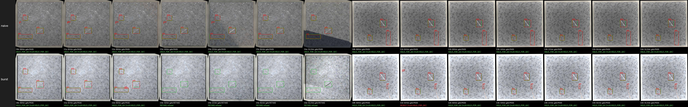
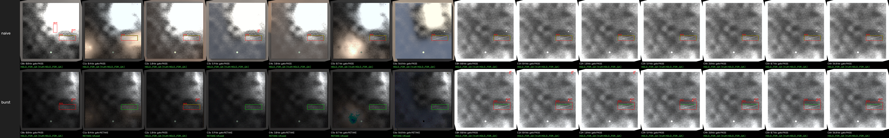
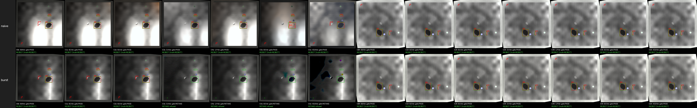

# Lighting experiment: does the inspector work in different lighting?

15 test plates (seeds >= 900000, never trained on); arms: naive, burst; created 2026-11-15T10:32:59.

## Verdict

- **FAIL** - Old method (one auto-exposed frame through the ISP): FAIL. In the dark room with the open device, 2 of 30 captures got a wrong verdict with no warning (0 unsafe: milder than the truth and not held, most often HOLD_FOR_QA (truth PASS)); under office ceiling light with the open device, 3 of 30 captures got a wrong verdict with no warning (0 unsafe: milder than the truth and not held, most often CLEAN_AND_REINSPECT (truth PASS)); under a warm bulb close by with the open device, 2 of 30 captures got a wrong verdict with no warning (0 unsafe: milder than the truth and not held, most often HOLD_FOR_QA (truth PASS)); under a low side lamp with a hand shadow with the open device, 1 of 30 captures got a wrong verdict with no warning (0 unsafe: milder than the truth and not held, most often HOLD_FOR_QA (truth PASS)); with a lamp reflected in the plate with the open device, 3 of 30 captures got a wrong verdict with no warning (0 unsafe: milder than the truth and not held, most often HOLD_FOR_QA (truth PASS)); in direct sun with the open device, 5 of 30 captures got a wrong verdict with no warning (0 unsafe: milder than the truth and not held, most often HOLD_FOR_QA (truth PASS)); ....
- **FAIL** - New method (5-frame LED burst, ambient subtraction, L/R combination, quality gate): FAIL. In the dark room with the open device, 4 of 30 captures got a wrong verdict with no warning (0 unsafe: milder than the truth and not held, most often HOLD_FOR_QA (truth REJECT)); under office ceiling light with the open device, 4 of 30 captures got a wrong verdict with no warning (2 unsafe: milder than the truth and not held, most often HOLD_FOR_QA (truth REJECT)); under a warm bulb close by with the open device, 1 of 30 captures got a wrong verdict with no warning (0 unsafe: milder than the truth and not held, most often HOLD_FOR_QA (truth REJECT)); with a lamp reflected in the plate with the open device, 3 of 30 captures got a wrong verdict with no warning (0 unsafe: milder than the truth and not held, most often HOLD_FOR_QA (truth REJECT)); under office ceiling light with the hood, 1 of 30 captures got a wrong verdict with no warning (0 unsafe: milder than the truth and not held, most often REJECT (truth HOLD_FOR_QA)); under a low side lamp with a hand shadow with the hood, 1 of 30 captures got a wrong verdict with no warning (0 unsafe: milder than the truth and not held, most often REJECT (truth HOLD_FOR_QA)).

## Pass criterion

HOOD (device v2, the product configuration), every condition C0-C6: retake rate <= 5 %, F1 >= F1(C0, hood) - 0.05, verdict agreement with C0 (hood) >= 95 % and 0 silent failures. OPEN (handheld without the hood): 0 silent failures in every condition; retakes allowed and reported per condition with the main gate reason. SSIM is against C0 of the same device.

Matching: same class and IoU >= 0.25 or box covers >= 50% of the true mask. Detections measured: box (padded box, like the ground truth). Ground-truth verdicts: rules engine on the ground-truth defects (box measures; visibility: c0). Silent failure = the gate let the capture through but the verdict is wrong; 'unsafe' = milder than the truth. P/R/F1 are over accepted (not retaken) captures; intervals are Wilson 95 % (F1 approximate; variants of one plate are not independent).

## naive arm, model naive: FAIL

| Row | Median lux | Captures | Retake | Main retake reason | Precision | Recall | F1 | FP / clean plate | Verdict = C0 | Verdict = truth | Silent (unsafe) | SSIM vs C0 | |Δ| vs C0 (DN) |
|---|---|---|---|---|---|---|---|---|---|---|---|---|---|
| C0o dark room | 0 | 30 | 0/30 | - | 0.76 [0.67, 0.84] | 0.95 [0.88, 0.98] | 0.85 [0.76, 0.91] | 0.33 | 30/30 | 28/30 | 2/30 (0) | 1.000 | 0.0 |
| C1o office ceiling light | 353 | 30 | 0/30 | - | 0.74 [0.65, 0.82] | 0.86 [0.76, 0.92] | 0.80 [0.70, 0.87] | 0.67 | 27/30 | 27/30 | 3/30 (0) | 0.950 | 7.8 |
| C2o warm bulb close by | 648 | 30 | 0/30 | - | 0.80 [0.71, 0.87] | 0.94 [0.86, 0.97] | 0.86 [0.77, 0.92] | 0.33 | 30/30 | 28/30 | 2/30 (0) | 0.987 | 3.7 |
| C3o window daylight | 3,569 | 30 | 0/30 | - | 0.81 [0.71, 0.88] | 0.91 [0.83, 0.96] | 0.86 [0.76, 0.92] | 0.00 | 28/30 | 30/30 | 0/30 (0) | 0.926 | 13.4 |
| C4o low side lamp with a hand shadow | 2,005 | 30 | 0/30 | - | 0.77 [0.67, 0.85] | 0.87 [0.78, 0.93] | 0.82 [0.72, 0.89] | 0.17 | 29/30 | 29/30 | 1/30 (0) | 0.964 | 9.2 |
| C5o a lamp reflected in the plate | 514 | 30 | 0/30 | - | 0.80 [0.70, 0.87] | 0.83 [0.74, 0.90] | 0.82 [0.72, 0.89] | 0.67 | 27/30 | 27/30 | 3/30 (0) | 0.868 | 21.7 |
| C6o direct sun | 44,872 | 30 | 0/30 | - | 0.87 [0.78, 0.93] | 0.95 [0.88, 0.98] | 0.91 [0.83, 0.95] | 0.67 | 27/30 | 25/30 | 5/30 (0) | 0.764 | 43.7 |
| C0h dark room + hood | 0 | 30 | 0/30 | - | 0.90 [0.81, 0.95] | 0.92 [0.84, 0.96] | 0.91 [0.82, 0.96] | 0.33 | 30/30 | 28/30 | 2/30 (0) | 1.000 | 0.0 |
| C1h office ceiling light + hood | 353 | 30 | 0/30 | - | 0.90 [0.81, 0.95] | 0.92 [0.84, 0.96] | 0.91 [0.82, 0.96] | 0.33 | 30/30 | 28/30 | 2/30 (0) | 1.000 | 0.0 |
| C2h warm bulb close by + hood | 648 | 30 | 0/30 | - | 0.90 [0.81, 0.95] | 0.92 [0.84, 0.96] | 0.91 [0.82, 0.96] | 0.33 | 30/30 | 28/30 | 2/30 (0) | 1.000 | 0.0 |
| C3h window daylight + hood | 3,569 | 30 | 0/30 | - | 0.91 [0.82, 0.96] | 0.92 [0.84, 0.96] | 0.92 [0.83, 0.96] | 0.33 | 30/30 | 28/30 | 2/30 (0) | 1.000 | 0.0 |
| C4h low side lamp with a hand shadow + hood | 2,005 | 30 | 0/30 | - | 0.91 [0.82, 0.96] | 0.92 [0.84, 0.96] | 0.92 [0.83, 0.96] | 0.33 | 30/30 | 28/30 | 2/30 (0) | 1.000 | 0.0 |
| C5h a lamp reflected in the plate + hood | 514 | 30 | 0/30 | - | 0.90 [0.81, 0.95] | 0.92 [0.84, 0.96] | 0.91 [0.82, 0.96] | 0.33 | 30/30 | 28/30 | 2/30 (0) | 1.000 | 0.0 |
| C6h direct sun + hood | 44,872 | 30 | 0/30 | - | 0.92 [0.84, 0.96] | 0.92 [0.84, 0.96] | 0.92 [0.84, 0.96] | 0.33 | 30/30 | 28/30 | 2/30 (0) | 0.989 | 0.3 |

Hood rows are compared with C0 hood, open rows with C0 open (verdicts and SSIM).

Checks:

- FAIL: C0o no silent failure (2 of 30 captures gave a wrong verdict without a retake (0 unsafe: milder than the truth, no hold))
- INFO: C0o retakes reported (the gate refused 0 of 30 captures)
- FAIL: C1o no silent failure (3 of 30 captures gave a wrong verdict without a retake (0 unsafe: milder than the truth, no hold))
- INFO: C1o retakes reported (the gate refused 0 of 30 captures)
- FAIL: C2o no silent failure (2 of 30 captures gave a wrong verdict without a retake (0 unsafe: milder than the truth, no hold))
- INFO: C2o retakes reported (the gate refused 0 of 30 captures)
- PASS: C3o no silent failure (0 of 30 captures gave a wrong verdict without a retake (0 unsafe: milder than the truth, no hold))
- INFO: C3o retakes reported (the gate refused 0 of 30 captures)
- FAIL: C4o no silent failure (1 of 30 captures gave a wrong verdict without a retake (0 unsafe: milder than the truth, no hold))
- INFO: C4o retakes reported (the gate refused 0 of 30 captures)
- FAIL: C5o no silent failure (3 of 30 captures gave a wrong verdict without a retake (0 unsafe: milder than the truth, no hold))
- INFO: C5o retakes reported (the gate refused 0 of 30 captures)
- FAIL: C6o no silent failure (5 of 30 captures gave a wrong verdict without a retake (0 unsafe: milder than the truth, no hold))
- INFO: C6o retakes reported (the gate refused 0 of 30 captures)
- FAIL: C0h no silent failure (2 of 30 captures gave a wrong verdict without a retake (0 unsafe: milder than the truth, no hold))
- PASS: C0h retake rate <= 5 % (the gate refused 0 of 30 captures)
- FAIL: C1h no silent failure (2 of 30 captures gave a wrong verdict without a retake (0 unsafe: milder than the truth, no hold))
- PASS: C1h retake rate <= 5 % (the gate refused 0 of 30 captures)
- PASS: C1h F1 within 0.05 of C0 (F1 0.909 vs C0 hood 0.909)
- PASS: C1h verdict = C0 >= 95 % (30 of 30 verdicts equal the C0 hood verdict)
- FAIL: C2h no silent failure (2 of 30 captures gave a wrong verdict without a retake (0 unsafe: milder than the truth, no hold))
- PASS: C2h retake rate <= 5 % (the gate refused 0 of 30 captures)
- PASS: C2h F1 within 0.05 of C0 (F1 0.909 vs C0 hood 0.909)
- PASS: C2h verdict = C0 >= 95 % (30 of 30 verdicts equal the C0 hood verdict)
- FAIL: C3h no silent failure (2 of 30 captures gave a wrong verdict without a retake (0 unsafe: milder than the truth, no hold))
- PASS: C3h retake rate <= 5 % (the gate refused 0 of 30 captures)
- PASS: C3h F1 within 0.05 of C0 (F1 0.915 vs C0 hood 0.909)
- PASS: C3h verdict = C0 >= 95 % (30 of 30 verdicts equal the C0 hood verdict)
- FAIL: C4h no silent failure (2 of 30 captures gave a wrong verdict without a retake (0 unsafe: milder than the truth, no hold))
- PASS: C4h retake rate <= 5 % (the gate refused 0 of 30 captures)
- PASS: C4h F1 within 0.05 of C0 (F1 0.915 vs C0 hood 0.909)
- PASS: C4h verdict = C0 >= 95 % (30 of 30 verdicts equal the C0 hood verdict)
- FAIL: C5h no silent failure (2 of 30 captures gave a wrong verdict without a retake (0 unsafe: milder than the truth, no hold))
- PASS: C5h retake rate <= 5 % (the gate refused 0 of 30 captures)
- PASS: C5h F1 within 0.05 of C0 (F1 0.909 vs C0 hood 0.909)
- PASS: C5h verdict = C0 >= 95 % (30 of 30 verdicts equal the C0 hood verdict)
- FAIL: C6h no silent failure (2 of 30 captures gave a wrong verdict without a retake (0 unsafe: milder than the truth, no hold))
- PASS: C6h retake rate <= 5 % (the gate refused 0 of 30 captures)
- PASS: C6h F1 within 0.05 of C0 (F1 0.921 vs C0 hood 0.909)
- PASS: C6h verdict = C0 >= 95 % (30 of 30 verdicts equal the C0 hood verdict)

## burst arm, model burst: FAIL

| Row | Median lux | Captures | Retake | Main retake reason | Precision | Recall | F1 | FP / clean plate | Verdict = C0 | Verdict = truth | Silent (unsafe) | SSIM vs C0 | |Δ| vs C0 (DN) |
|---|---|---|---|---|---|---|---|---|---|---|---|---|---|
| C0o dark room | 0 | 30 | 6/30 | saturated | 0.81 [0.71, 0.88] | 0.82 [0.72, 0.89] | 0.82 [0.72, 0.89] | n/a | 24/24 | 20/24 | 4/30 (0) | 1.000 | 0.0 |
| C1o office ceiling light | 353 | 30 | 17/30 | changed | 0.80 [0.64, 0.90] | 0.72 [0.56, 0.83] | 0.76 [0.60, 0.87] | n/a | 11/13 | 9/13 | 4/30 (2) | 0.927 | 2.8 |
| C2o warm bulb close by | 648 | 30 | 13/30 | changed | 0.77 [0.65, 0.86] | 0.85 [0.74, 0.92] | 0.81 [0.69, 0.89] | n/a | 16/17 | 16/17 | 1/30 (0) | 0.930 | 2.7 |
| C3o window daylight | 3,569 | 30 | 26/30 | glare_ambient | 0.92 [0.67, 0.99] | 0.86 [0.60, 0.96] | 0.89 [0.63, 0.97] | n/a | 4/4 | 4/4 | 0/30 (0) | 0.900 | 3.4 |
| C4o low side lamp with a hand shadow | 2,005 | 30 | 27/30 | changed | 0.89 [0.56, 0.98] | 0.73 [0.43, 0.90] | 0.80 [0.49, 0.94] | n/a | 3/3 | 3/3 | 0/30 (0) | 0.915 | 3.0 |
| C5o a lamp reflected in the plate | 514 | 30 | 23/30 | glare_ambient | 0.76 [0.53, 0.90] | 0.68 [0.46, 0.85] | 0.72 [0.49, 0.88] | n/a | 7/7 | 4/7 | 3/30 (0) | 0.919 | 3.1 |
| C6o direct sun | 44,872 | 30 | 30/30 | too_bright | n/a | n/a | n/a | n/a | n/a | n/a | 0/30 (0) | n/a | n/a |
| C0h dark room + hood | 0 | 30 | 0/30 | - | 0.78 [0.68, 0.86] | 0.89 [0.81, 0.95] | 0.83 [0.74, 0.90] | 0.00 | 30/30 | 30/30 | 0/30 (0) | 1.000 | 0.0 |
| C1h office ceiling light + hood | 353 | 30 | 0/30 | - | 0.78 [0.68, 0.85] | 0.91 [0.82, 0.95] | 0.84 [0.74, 0.90] | 0.00 | 29/30 | 29/30 | 1/30 (0) | 0.939 | 2.8 |
| C2h warm bulb close by + hood | 648 | 30 | 0/30 | - | 0.78 [0.69, 0.86] | 0.91 [0.82, 0.95] | 0.84 [0.75, 0.90] | 0.00 | 30/30 | 30/30 | 0/30 (0) | 0.941 | 2.7 |
| C3h window daylight + hood | 3,569 | 30 | 0/30 | - | 0.79 [0.70, 0.86] | 0.91 [0.82, 0.95] | 0.85 [0.75, 0.91] | 0.00 | 30/30 | 30/30 | 0/30 (0) | 0.940 | 2.7 |
| C4h low side lamp with a hand shadow + hood | 2,005 | 30 | 0/30 | - | 0.79 [0.70, 0.86] | 0.91 [0.82, 0.95] | 0.85 [0.75, 0.91] | 0.00 | 29/30 | 29/30 | 1/30 (0) | 0.939 | 2.8 |
| C5h a lamp reflected in the plate + hood | 514 | 30 | 0/30 | - | 0.78 [0.69, 0.86] | 0.91 [0.82, 0.95] | 0.84 [0.75, 0.90] | 0.00 | 30/30 | 30/30 | 0/30 (0) | 0.939 | 2.8 |
| C6h direct sun + hood | 44,872 | 30 | 0/30 | - | 0.77 [0.67, 0.85] | 0.89 [0.81, 0.95] | 0.83 [0.73, 0.90] | 0.00 | 30/30 | 30/30 | 0/30 (0) | 0.940 | 2.7 |

Hood rows are compared with C0 hood, open rows with C0 open (verdicts and SSIM).

Checks:

- FAIL: C0o no silent failure (4 of 30 captures gave a wrong verdict without a retake (0 unsafe: milder than the truth, no hold))
- INFO: C0o retakes reported (the gate refused 6 of 30 captures (main reason: saturated))
- FAIL: C1o no silent failure (4 of 30 captures gave a wrong verdict without a retake (2 unsafe: milder than the truth, no hold))
- INFO: C1o retakes reported (the gate refused 17 of 30 captures (main reason: changed))
- FAIL: C2o no silent failure (1 of 30 captures gave a wrong verdict without a retake (0 unsafe: milder than the truth, no hold))
- INFO: C2o retakes reported (the gate refused 13 of 30 captures (main reason: changed))
- PASS: C3o no silent failure (0 of 30 captures gave a wrong verdict without a retake (0 unsafe: milder than the truth, no hold))
- INFO: C3o retakes reported (the gate refused 26 of 30 captures (main reason: glare_ambient))
- PASS: C4o no silent failure (0 of 30 captures gave a wrong verdict without a retake (0 unsafe: milder than the truth, no hold))
- INFO: C4o retakes reported (the gate refused 27 of 30 captures (main reason: changed))
- FAIL: C5o no silent failure (3 of 30 captures gave a wrong verdict without a retake (0 unsafe: milder than the truth, no hold))
- INFO: C5o retakes reported (the gate refused 23 of 30 captures (main reason: glare_ambient))
- PASS: C6o no silent failure (0 of 30 captures gave a wrong verdict without a retake (0 unsafe: milder than the truth, no hold))
- INFO: C6o retakes reported (the gate refused 30 of 30 captures (main reason: too_bright))
- PASS: C0h no silent failure (0 of 30 captures gave a wrong verdict without a retake (0 unsafe: milder than the truth, no hold))
- PASS: C0h retake rate <= 5 % (the gate refused 0 of 30 captures)
- FAIL: C1h no silent failure (1 of 30 captures gave a wrong verdict without a retake (0 unsafe: milder than the truth, no hold))
- PASS: C1h retake rate <= 5 % (the gate refused 0 of 30 captures)
- PASS: C1h F1 within 0.05 of C0 (F1 0.836 vs C0 hood 0.834)
- PASS: C1h verdict = C0 >= 95 % (29 of 30 verdicts equal the C0 hood verdict)
- PASS: C2h no silent failure (0 of 30 captures gave a wrong verdict without a retake (0 unsafe: milder than the truth, no hold))
- PASS: C2h retake rate <= 5 % (the gate refused 0 of 30 captures)
- PASS: C2h F1 within 0.05 of C0 (F1 0.841 vs C0 hood 0.834)
- PASS: C2h verdict = C0 >= 95 % (30 of 30 verdicts equal the C0 hood verdict)
- PASS: C3h no silent failure (0 of 30 captures gave a wrong verdict without a retake (0 unsafe: milder than the truth, no hold))
- PASS: C3h retake rate <= 5 % (the gate refused 0 of 30 captures)
- PASS: C3h F1 within 0.05 of C0 (F1 0.847 vs C0 hood 0.834)
- PASS: C3h verdict = C0 >= 95 % (30 of 30 verdicts equal the C0 hood verdict)
- FAIL: C4h no silent failure (1 of 30 captures gave a wrong verdict without a retake (0 unsafe: milder than the truth, no hold))
- PASS: C4h retake rate <= 5 % (the gate refused 0 of 30 captures)
- PASS: C4h F1 within 0.05 of C0 (F1 0.847 vs C0 hood 0.834)
- PASS: C4h verdict = C0 >= 95 % (29 of 30 verdicts equal the C0 hood verdict)
- PASS: C5h no silent failure (0 of 30 captures gave a wrong verdict without a retake (0 unsafe: milder than the truth, no hold))
- PASS: C5h retake rate <= 5 % (the gate refused 0 of 30 captures)
- PASS: C5h F1 within 0.05 of C0 (F1 0.841 vs C0 hood 0.834)
- PASS: C5h verdict = C0 >= 95 % (30 of 30 verdicts equal the C0 hood verdict)
- PASS: C6h no silent failure (0 of 30 captures gave a wrong verdict without a retake (0 unsafe: milder than the truth, no hold))
- PASS: C6h retake rate <= 5 % (the gate refused 0 of 30 captures)
- PASS: C6h F1 within 0.05 of C0 (F1 0.829 vs C0 hood 0.834)
- PASS: C6h verdict = C0 >= 95 % (30 of 30 verdicts equal the C0 hood verdict)

Gate messages shown to the operator:

- 54 x "Lighting changed during capture (flicker or moving shadow): retake."
- 34 x "Lamp reflection on the part: tilt, shade it or fit the hood, then retake."
- 34 x "Too bright: shade the part or fit the hood, then retake."
- 19 x "Glare: tilt the device about 10 degrees and retake."
- 6 x "Ambient light is high: result kept, but shade the part if you can."
- 1 x "Hold still and retake."

## Figures

