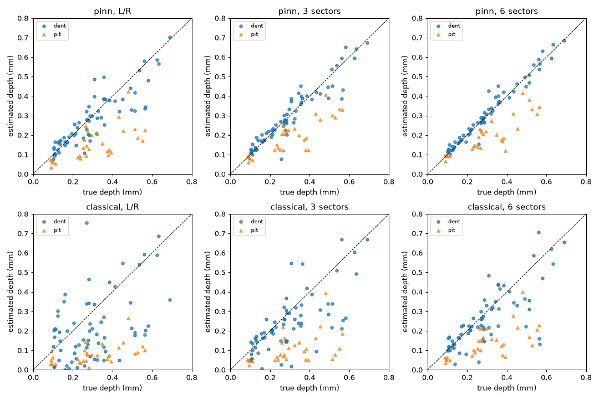
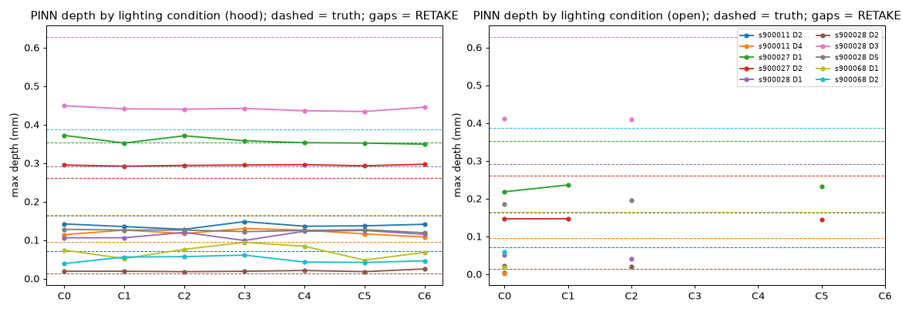

# Physics, forward model and PINN depth: results on the twin (15 Nov 2026)

- **Contract and method:** `docs/twin/PHYSICS_PINN.md`.
- **Code:** `src/ayas/physics/`.
- **Raw tables:** `reports/physics_pinn_tables.md` and `.json`. Regenerate them with:

  ```bash
  python -m ayas.physics.experiments summarise --coupons <coupons.jsonl> --pilot <pilot.jsonl> --bench <bench.json> --out reports/physics_pinn_tables.md
  ```

**Read this first.**
- Every number is measured **on the twin**: Blender 5.2.3 renders, plus the project's burst and noise simulation.
- Nothing here has been measured on real metal or on the Pi.
- The twin's relief is a normal map. It has no cast shadows, no inter-reflection inside a dent, and a tilt cap of about 45° (§6).

## 1. Summary

**1. The forward model matches Blender** when the light path is direct (open device, pods):
- flat metal within 0.1–0.9 % at the median (p10–p90 within −5.5 to +1.1 %), across aluminium, mill scale, brushed stainless and cold-rolled;
- ball dents within 0.2–1.1 % (pixel correlation 0.99 or more);
- no fitted parameters.

**2. Under the hood, the direct model under-predicts flat metal by 2–57 %.**
- A control render with a black hood (albedo 0) closes most of the gap (aluminium: 0.85 / 0.76 → 0.96 / 0.94 on L / R). The cause is the hood's own inter-reflection, which polished metal mirrors into the lens.
- A one-bounce hood model reproduces the bounce at dents (pixel correlation 0.88–0.94, means within 1.04–1.36×).
- It does not reproduce its spatial spread, and that is the main remaining model error.

**3. PINN depth on 96 twin dents and pits** (6 materials, 18 per-LED Blender passes, dark room, sensor noise):

| | L/R (today) | 3 sectors | 6 sectors |
|---|---|---|---|
| PINN, dents, MAE | 0.053 mm | 0.034 mm | 0.021 mm |
| PINN, dents, within 0.05 mm | 62 % | 79 % | 92 % |
| Classical slopes + Poisson, dents, MAE | 0.153 mm | 0.089 mm | 0.071 mm |
| PINN, pits, MAE (bias) | 0.154 mm (−0.154) | 0.114 mm | 0.107 mm |

- **The PINN beats the classical baseline in every configuration**: by 2.1–3.4× on dents (coupons and pilot) and 1.5–1.8× on pits.
- **Pits are not measured reliably**: median under-estimate 28–54 % on the coupons and 55–88 % on the pilot pits. They span 2–20 px, and the twin clamps their walls at about 45°.

**4. Lighting invariance (pilot plates, real burst path, all 7 conditions).**
- With the hood, the PINN depth changes across C0–C6 (dark room to full sun) by at most 0.023 mm for dents and scratch windows, and 0.026–0.046 mm for the pits, which are not measured reliably anyway. That is the noise of the estimate, not a trend.
- **Accuracy is a separate question.** Against the truth:

  | Dent | True | Estimated (all 7 conditions) |
  |---|---|---|
  | 1.4 mm punch dent, mill scale | 0.353 mm | 0.349–0.372 mm |
  | 6.9 mm ball dent, aluminium | 0.163 mm | 0.119–0.128 mm |
  | 5.7 mm ball dent, aluminium | 0.627 mm | 0.434–0.449 mm (−30 %, the hood bounce) |

- Open mode (pods) refuses most captures, as designed. Where it accepts, the depth is 34 % low on mill scale.

**5. Severity.**
- The proposed rule uses a depth only when the fit converged, the calibrated 90 % interval is ≤ 0.08 mm, and the interval does not cross a limit.
- Under that rule, **no** depth-based decision was more lenient than the decision made with the true depth:
  - coupons: 0 of 11 / 30 / 48 decisions (L/R / 3 / 6 sectors);
  - pilot: 0 of 7 hood captures.
- Every other case keeps today's rule. With 6 sectors the depth decides half the coupon dents and pits; with L/R it decides 11 %.

**6. L/R or sectors?**
- **L/R is enough for mill scale and for detection.** For depth on polished metal it is not: with L/R, aluminium, galvanised and stainless have 2.4–4.7× the dent error of the 6-sector burst.
- **Recommendation:** an optional depth burst with the 6 ring modules on 6 switched channels (B1, S0…S5, A, B2), taken only when a dent is found. 3 sectors gives about half the gain.

**7. Runtime (Mac M3, shared with other jobs).**
- One dent with 2 seeds takes 15–22 s on 1 thread and 12.5–27 s on 4 threads; a pit takes 34 s.
- **Pi 5, projected, not measured:** 1–1.5 min per dent, 2 min per pit.

**8. Uniform-corrosion forecast:** built and cited (ISO 9223 / ISO 9224), and labelled advisory.

## 2. Forward model against Blender (validation)

**Method.**
- **Data:** the pilot EXRs (4 test plates; Blender 5.2.3 Cycles; 64 spp; full resolution). The L and R light-group passes are rectified with `post.grid_geometry` and `post.rectify` exactly as post does, then multiplied by the fixed exposure k (`burst.exposure_k`).
- **Model:** `optics`, evaluated on the plate's 0.04 mm texel grid with the ground-truth maps from `textures.render_maps` (height, albedo, roughness, metallic, plus the plan's anisotropy and grain). The result is blurred by a Gaussian with σ = 0.035 mm and resampled at the grid pixel centres.
- **No fitted parameters:** no scale fit and no roughness fit.
- **"Flat"** means the plate interior more than 2 mm from the edges and at least 1 mm from every footprint, compared on 8 × 8 px bins.

### 2.1 Open device (handheld pods)

| Plate | Material | Flat L, model/Blender: median (p10–p90) | Flat R | Dents / gouge: mean ratio (pixel corr) |
|---|---|---|---|---|
| s900028 | aluminium | 0.995 (0.990–1.001) | 0.997 (0.992–1.002) | ball dents: 0.989–0.998 (0.994–0.998) |
| s900027 | hot-rolled, mill scale (metallic 0.45) | 0.993 (0.986–0.997) | 0.993 (0.985–0.997) | punch dent: 0.973–0.979 (0.80–0.99); gouge: 0.994–0.995 (0.997–0.998) |
| s900068 | brushed SS (anisotropy 0.53) | 0.996 (0.980–1.005) | 0.999 (0.989–1.011) | – |
| s900011 | cold-rolled (anisotropy 0.39) | 0.993 (0.970–1.007) | 0.991 (0.945–1.008) | – |

Where it does not match:
- **Pits** (2–7 px wide, steep, darkened by the texture generator): mean ratio 0.59–1.51, pixel correlation 0.15–0.97. Sub-pixel registration and the point-spread function dominate there.
- **Thin scribed scratches:** 0.80–1.27.

### 2.2 Hood (dark-field ring)

Direct model only, flat metal, median model/Blender:

| Material | L | R |
|---|---|---|
| hot-rolled | 0.976 | 0.974 |
| aluminium | 0.851 | 0.761 |
| brushed SS | 0.678 | 0.707 |
| cold-rolled | 0.434 | 0.491 |

The shinier the plate, the larger the gap. The residual is additive and largest on the side away from the group's LEDs (`figures/physics_validation_hood_aluminium.png`).

**Control: one extra Blender render** (`experiments hood0`). The same aluminium scene with `extras.hood.albedo = 0`:
- flat 0.963 / 0.938, log-correlation 0.992 / 0.993;
- the 5.7 mm dent 0.958 / 1.021, where it was 0.630 / 0.975;
- `figures/physics_validation_hood0_aluminium.png`.

**So the gap is the hood's inter-reflection, not the BRDF.** A floor of about 0.001 FS remains in the darkest areas; it is not explained.

**One-bounce hood model** (`optics.hood_env`: LED → wall, and LED → plate mirror → wall, then mirrored into the lens), against Blender's (hood − hood0):

| Crop | Blender bounce (FS) | Model bounce (FS) | Pixel corr |
|---|---|---|---|
| D3 dent, L | 0.0025 | 0.0034 | 0.92 |
| D3 dent, R | 0.0023 | 0.0025 | 0.94 |
| D5 dent, R | 0.0054 | 0.0056 | 0.88 |
| flat crops | 0.0004–0.0033 | 0.4–3.7 × Blender | −0.05 to 0.68 |

- The model puts the dent bounce on the rim; Blender spreads it over the half-dent (`figures/physics_hood_bounce_D3.png`).
- Integrating the plate's full BRDF over its area, instead of using mirror images, changed the maps by only a few per cent.

Direct + bounce against the full hood render, relative RMS over 6–8 mm crops:

| Material | Direct only | Direct + bounce |
|---|---|---|
| hot-rolled | 3–7 % | 2–5 % |
| aluminium | 7–49 % | 4–15 % |
| brushed SS | 15–57 % | 14–21 % |
| cold-rolled (signal 0.003 FS) | 45–85 % | 35–44 % |

The depth fit keeps this bounce model, with a learnable gain and a small offset per LED group.

## 3. Depth on the twin coupons (the main accuracy test)

### 3.1 Setup

- **Plates:** six 100 × 100 mm plates, one per material (seeds 910000–910062; none is a training or matrix seed). Each carries 16 defects:
  - ball dents 3–10 mm, 0.1–0.7 mm deep;
  - elliptic dents with aspect 1.5–2;
  - punch dents 1.5 / 2.5 mm;
  - single pits 0.4–1.5 mm, 0.1–0.5 mm deep.
- **Renders:** hood, dark room, 64 spp, with **one Blender light group per ring LED** (E00–E17). Six renders of 34–51 s each, through the unchanged `render_scene.py`.
- **Partitions:** L/R and the 3- and 6-sector frames are exact sums of the per-LED passes.
- **Noise:** the frames get the sensor's shot and read noise for L − A in the dark (capture.yaml sensor). There is no hand shake and no ambient; the pilot covers those.
- **Truth:** the depth below the median of the footprint's 1 mm surround, from `textures.render_maps` height.
- **PINN:** one seed (the sweep's budget).



### 3.2 Depth error by partition and method

| LED groups | Method | Class | n | MAE mm | Median abs mm | Bias mm | Within 0.05 mm | Within 25 % | Median error / EN 10163-2 T1 | Converged |
|---|---|---|---|---|---|---|---|---|---|---|
| L/R | PINN | dent | 66 | 0.053 | 0.035 | −0.020 | 62 % | 68 % | 0.34 | 73 % |
| L/R | PINN | pit | 30 | 0.154 | 0.137 | −0.154 | 20 % | 17 % | 0.77 | 13 % |
| L/R | classical | dent | 66 | 0.153 | 0.131 | −0.082 | 17 % | 23 % | 0.49 | – |
| L/R | classical | pit | 30 | 0.226 | 0.213 | −0.225 | 10 % | 3 % | 1.35 | – |
| 3 sectors | PINN | dent | 66 | 0.034 | 0.021 | −0.001 | 79 % | 86 % | 0.08 | 80 % |
| 3 sectors | PINN | pit | 30 | 0.114 | 0.096 | −0.113 | 27 % | 37 % | 0.63 | 30 % |
| 3 sectors | classical | dent | 66 | 0.089 | 0.050 | −0.057 | 48 % | 52 % | 0.64 | – |
| 6 sectors | PINN | dent | 66 | 0.021 | 0.013 | +0.009 | 92 % | 94 % | 0.06 | 80 % |
| 6 sectors | PINN | pit | 30 | 0.107 | 0.091 | −0.106 | 30 % | 33 % | 0.55 | 40 % |
| 6 sectors | classical | dent | 66 | 0.071 | 0.045 | −0.037 | 55 % | 64 % | 0.42 | – |

T1 is the EN 10163-2 / ISO 7788 Table 1 limit for the plate's thickness: 0.2 mm for 3–8 mm, 0.3 mm above 8 mm.

### 3.3 PINN dent MAE by material

| Material | L/R | 3 sectors | 6 sectors |
|---|---|---|---|
| ms_hot_rolled (mill scale) | 0.012 mm (100 % ≤ 0.05) | 0.016 | 0.011 |
| ms_cold_rolled | 0.027 (82 %) | 0.023 | 0.016 |
| ss_2b | 0.056 (55 %) | 0.020 | 0.012 |
| ss_brushed | 0.066 (55 %) | 0.044 | 0.027 |
| galvanised | 0.077 (45 %) | 0.047 | 0.026 |
| aluminium | 0.077 (36 %) | 0.056 | 0.032 |

### 3.4 Uncertainty

- The ensemble spread is far smaller than the systematic error, so the interval adds a calibrated term:
  `ci = sqrt((1.645 sd)² + (SYS_REL·d)² + 0.02²)`.
- SYS_REL is the 90th percentile of the coupon errors per class and partition:

  | Class | L/R | 3 sectors | 6 sectors |
  |---|---|---|---|
  | dents | 0.46 | 0.23 | 0.10 |
  | pits | 2.15 | 1.12 | 1.06 |

- It is installed in `depth_pinn.SYS_REL_TABLE`.
- Coverage on the coupons is about 90 % by construction. **Out of sample on the pilot plates** (§4):
  - hood dents: 21 / 21 inside the interval (100 %; the L/R interval is wide);
  - pits: 62 %.
- Scratches have no calibrated interval yet.

### 3.5 Dispositions (rules with the estimated depth vs with the true depth)

`physics.severity.judge_with_depth` uses a depth only when it converged, ci ≤ 0.08 mm, and [d − ci, d + ci] lies inside one EN 10163-2 band. Otherwise today's rule applies. Counted over the 96 coupon defects:

| LED groups | Method | Depth used | Used and agrees with true-depth disposition | More lenient because of the depth | More lenient from the fallback (today's rule) | Today's rules agree / more lenient / stricter |
|---|---|---|---|---|---|---|
| L/R | PINN | 11 | 11 | **0** | 19 | 34 / 23 / 39 |
| 3 sectors | PINN | 30 | 30 | **0** | 15 | |
| 6 sectors | PINN | 48 | 48 | **0** | 10 | |
| L/R | classical (same interval calibration) | 4 | 4 | 0 | 23 | |
| 6 sectors | classical | 5 | 5 | 0 | 22 | |

- **Today's rules are more lenient than the true-depth rule for 23 coupon defects.** These are small but deep dents and pits that the size bands pass. The coupons contain several of them by design.
- Today's rules are stricter (HOLD) for 39: shallow dents that EN 10163-2 Table 1 would let stay.
- The depth estimate fixes some of both. Where it is not trusted, it changes nothing.

## 4. Lighting invariance: pilot plates through the real capture path

**Setup.**
- The 56 pilot scenes: 4 test plates × 7 conditions × {hood, open}.
- Each scene goes through `burst.simulate_burst`: noise, shake, LED jitter, ambient (each render's own AMB pass), moving shadows and flicker.
- Then `lightproc.process_burst` (current code, re-run after the 15 Nov 07:12 lightproc / capture.yaml change) gives the shifts and the gate.
- Then the aligned Lc = L − A and Rc = R − A (unclipped) are rectified, and the PINN and the classical baseline run per dent, pit and scratch window.
- A RETAKE capture is not judged, as in the app.



| Plate | Defect | Material, t (mm) | True mm | Hood: PINN median [min–max] (n, retakes) | Open: PINN median [min–max] (n, retakes) | Classical, hood | Disposition: true / today / estimated (hood) |
|---|---|---|---|---|---|---|---|
| s900027 | D1 punch dent 1.4 mm | hot-rolled, 5.2 | 0.353 | **0.353** [0.349–0.372] (7, 0) | 0.232 [0.218–0.236] (3, 4) | 0.141 | PASS / PASS / PASS ×7 |
| s900028 | D5 ball dent 6.9 mm | aluminium, 5.7 | 0.163 | 0.126 [0.119–0.128] (7, 0) | 0.191 [0.186–0.195] (2, 5) | 0.187 | **PASS / REJECT / PASS ×7** |
| s900028 | D3 ball dent 5.7 mm | aluminium, 5.7 | 0.627 | 0.441 [0.434–0.449] (7, 0) | 0.410 [0.409–0.412] (2, 5) | 0.375 | REJECT / REJECT / REJECT ×7 |
| s900028 | D1 pit cluster | aluminium, 5.7 | 0.292 | 0.115 [0.099–0.125] (7, 0) | 0.045 (2, 5) | 0.039 | PASS / PASS / PASS ×7 |
| s900068 | D1 pit cluster | brushed SS, 4.9 | 0.165 | 0.074 [0.048–0.094] (7, 0) | 0.018 (1, 6) | 0.042 | PASS / HOLD / HOLD ×7 |
| s900068 | D2 single pit 0.49 mm | brushed SS, 4.9 | 0.388 | 0.046 [0.039–0.061] (7, 0) | 0.058 (1, 6) | 0.035 | REWORK / HOLD / HOLD ×7 |
| s900027 | D2 gouge 1.9 mm (3 mm window) | hot-rolled | 0.260 | 0.295 [0.292–0.297] (7, 0) | 0.147 (3, 4) | 0.270 | HOLD / HOLD / HOLD ×7 |
| s900011 | D2 scriber 0.24 mm | cold-rolled, 2.5 | 0.071 | 0.137 [0.128–0.148] (7, 0) | 0.004 (1, 6) | 0.123 | REWORK / HOLD / HOLD ×7 |
| s900011 | D4 scriber 0.39 mm | cold-rolled, 2.5 | 0.095 | 0.117 [0.108–0.130] (7, 0) | 0.002 (1, 6) | 0.054 | REWORK / HOLD / HOLD ×7 |
| s900028 | D2 scriber 0.11 mm | aluminium, 5.7 | 0.013 | 0.019 [0.018–0.025] (7, 0) | 0.022 (2, 5) | 0.080 | PASS / PASS / PASS ×7 |

**Error over every accepted capture, all 7 conditions** (`physics_pinn_tables.md`):

| Mode | Class | n | MAE mm | Median abs mm | Bias mm | Within 0.05 mm | Converged |
|---|---|---|---|---|---|---|---|
| hood | dents (3 dents × 7 conditions) | 21 | 0.077 | 0.037 | −0.073 | 67 % | 76 % |
| hood | dents, classical | 21 | 0.164 | 0.212 | −0.146 | 33 % | – |
| hood | pits | 21 | 0.204 | 0.177 | −0.204 | 0 % | 0 % |
| hood | scratch windows | 28 | 0.033 | 0.032 | +0.033 | 75 % | 18 % |
| open | dents | 7 | 0.123 | 0.121 | −0.107 | 29 % | 100 % |

**Reading the pilot.**
- **Invariance.** With the hood, each dent's and scratch window's estimate stays within 0.005–0.023 mm (max − min), and each pit's within 0.026–0.046 mm, across dark room, office, warm bulb, window, side lamp with a moving hand shadow, reflected lamp and full sun.
  - This is expected: the hood blocks ambient (by 5000× or more), and ambient subtraction removes what leaks.
  - It is still the measured property the user asked for: **the depth does not depend on the room light.**
- **Accuracy is not invariant across materials.** Mill scale is right (0.353 vs 0.353 mm). Polished aluminium is 23–30 % low under the hood with L/R. The one-bounce hood model is imperfect (§2.2); the coupons show that sectors reduce this (§3.3).
- **Open (pods).** RETAKE in 4–6 of 7 conditions per plate, as designed. When accepted, the depth is biased: −34 % on the mill-scale dent. Near-coaxial pods give little slope contrast on flat-lit metal, and thin scribers vanish. **Depth should run only with the hood.**
- **Severity (hood, 42 dent and pit captures).**
  - The depth was used in 7: D5 in all 7 conditions. All 7 agree with the true-depth disposition (PASS), where today's size rule says REJECT for a 6.9 mm dent that is only 0.16 mm deep.
  - 0 decisions were more lenient because of the depth. The other 35 kept today's disposition.
  - D1 (0.353 mm, very accurate) was not used: its L/R interval of ±0.16 mm crosses the 0.4 mm Table 2 limit. That is exactly the case a sector burst would decide.

## 5. Light directions: is L/R enough?

The evidence:
- §3.2, paired on the same 96 defects: dent MAE goes 0.053 → 0.034 → 0.021 mm, and the share of decisions the depth can make goes 11 → 31 → 50 %.
- §3.3: the gain is concentrated on polished metal. Mill scale is already 0.012 mm with L/R.

The physics:
- In dark-field, GGX is in its tail, D ≈ α²/sin⁴θ_h. Roughness and local albedo (a burnished dent floor) act as one per-pixel factor shared by all groups. Only the ratios between groups carry the slope.
- With L/R, one ratio gives the slope along the L–R axis. The perpendicular slope comes only from the boundary condition and integrability, and is never over-determined.
- With 3 or more sectors the slope is over-determined, so material and slope separate.

**Recommendation.**
- **Keep L/R for the standard burst.** It is all that detection and the gate need.
- **Add an optional depth burst**, B1, S0…S5, A, B2, taken only when a dent or pit is detected and the hood is fitted.
- **Hardware:** drive the six 3-LED modules on six MOSFET channels (four more GPIO). L/R and 3 sectors are then software choices.
- Cost: 4 more frames, about 0.4 s at 10 fps full resolution, only when needed.
- 3 sectors (one extra channel) gives roughly half the gain.

**Blender needs no change.** The coupons used 18 light groups through the unchanged `render_scene.py`. The twin and device diffs are in `PHYSICS_PINN.md` §5.5.

## 6. Limits (what this does not show)

**The renderer.**
- Twin relief is a normal map. Real dents and pits self-shadow under 8–12° light, and their walls inter-reflect.
- The model has `shadows=True` for hardware, but no Blender ground truth exists for it: displacement renders were not made.
- Cycles caps shading normals at about 45°, so steep pit walls (58° on s900068 D2) look like 45° walls. Part of the pit under-estimation is this cap; part is resolution, 2–7 px.

**Materials.**
- Real BRDFs differ from Principled v2: mill-scale oxide layers, brushed anisotropy with micro-grooves, coatings, oil films.
- Only the twin's own materials were tested.
- Grain direction is estimated from the whole plate. It was 20° off on a cold-rolled plate dominated by a rust patch.

**The hood bounce** is only partly modelled (§2.2) and depends on the real hood's paint. A flocked interior (albedo about 0.01) would cut it about 3×. The black-hood control shows what that buys: in a development run on the noise-free albedo-0 render, D3 came out at 0.609 vs 0.627 mm.

**Specular dark-field** on very smooth metal gives a flat-area signal of 0.003–0.02 FS (30–190 e⁻), so per-pixel noise matters there.

**Coupons.**
- Single-seed PINN, dark room, no hand shake.
- Pits only as single cones; dents only as ball, elliptic and punch shapes.
- The 96 defects are 6 plates. Material-level numbers come from 11 dents each.

**Time on the Pi** is projected from the Mac, not measured. torch is not in the app venv.

**The interval is calibrated on the twin.** It means nothing for real metal until it is re-calibrated on measured coupons: dents pressed into real plates and gauged.

## 7. Runtime

Mac (Apple M3), torch 2.15 on CPU, wall time. Other jobs shared the machine (load average 37–111), so treat these as upper bounds.

| Threads | Defect | Crop (grid px) | Working lattice (block) | PINN, 2 seeds | Classical |
|---|---|---|---|---|---|
| 1 | pit 0.8 mm | 30 | 30×31 (1×, rendered at 0.04 mm) | 33.6 s | 5.7 s |
| 1 | dent 3 mm | 71 | 36×36 (2×) | 16.5 s | 5.5 s |
| 1 | dent 5 mm | 119 | 39×40 (3×) | 15.1 s | 7.6 s |
| 1 | dent 6 mm | 142 | 47×47 (3×) | 16.5 s | 9.8 s |
| 1 | dent 10 mm | 238 | 47×47 (5×) | 22.4 s | 11.3 s |
| 4 | the same five | | | 12.5–50 s | 5.2–13.2 s |

- 4 threads give no reliable gain at these lattice sizes on a loaded machine. On the Pi it is better to fit up to 4 defects in parallel, one per core.
- **Pi 5 projection** (Cortex-A76: about 3.5–4× slower single-core than an M3 for float32 vector work; a projection, not a measurement): about 1–1.5 min per dent with 2 seeds, 0.5–0.75 min with 1 seed, about 2 min per pit.
- That fits a "measure this dent" step after detection. It does not fit an inline step on every capture.
- An amortised network, trained on JarvisLabs from twin renders and refined by about 20 PINN steps, is the route to seconds. It is described in `PHYSICS_PINN.md` §7 and not built.

## 8. Uniform-corrosion forecast (stretch)

`physics.corrosion.forecast(material, thickness_mm, category)` gives years until the thickness falls to a limit (default: 4 % loss, IS 2062 cl. 7 local grinding allowance). For a 5 mm plate, from one face, in years (fastest / typical / slowest):

| Material | C2 | C3 | C5 |
|---|---|---|---|
| carbon steel | 35 / 103 / 1210 | 11 / 24 / 46 | 1.0 / 2.0 / 5.8 |
| galvanised (85 µm zinc assumed) | 236 / 556 / 3036 | 76 / 151 / 303 | 15 / 26 / 45 |

Sources and caveats:
- Rates: ISO 9223:2012 Table 2.
- Exponents: ISO 9224:2012 Table 2. B1 / B2: carbon steel 0.523 / 0.575, zinc 0.813 / 0.873, aluminium 0.728 / 0.807. These were checked against the ISO preview text, and the tests reproduce Table 3.
- Aluminium corrodes by pitting, so its uniform rate understates the damage. Stainless is not covered and returns None.
- The output is labelled *uniform-corrosion forecast, advisory, not pit growth*.

## 9. Reproduce

All scratch paths are under the session scratchpad.

```bash
# coupon renders (6 x ~40 s Blender; per-LED light groups) and the black-hood control
python -m ayas.physics.experiments coupons --out <scratch>/renders
python -m ayas.physics.experiments hood0  --out <scratch>/renders --scene <pilot exr>/s900028_C0h
# depth sweeps (CPU; torch)
python -m ayas.physics.experiments coupon-depth --renders <scratch>/renders --out coupons.jsonl --parts 2 3 6 --seeds 1
python -m ayas.physics.experiments pilot --exr-root <pilot exr> --out pilot.jsonl --seeds 1
python -m ayas.physics.experiments bench --work <scratch>/renders/coupon_aluminium_910002 --out bench.json --ids D12 D1 D13 D6 D10
python -m ayas.physics.experiments summarise --coupons coupons.jsonl --pilot pilot.jsonl --bench bench.json --out reports/physics_pinn_tables.md
```
